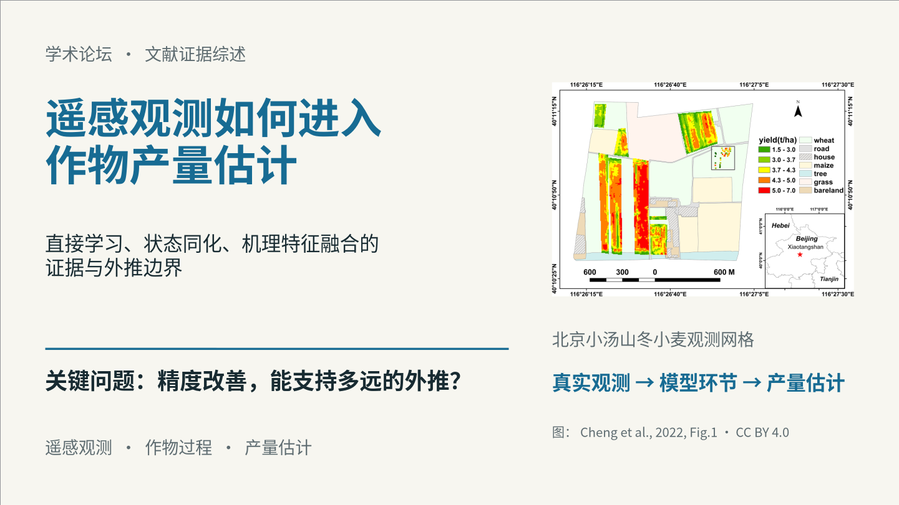
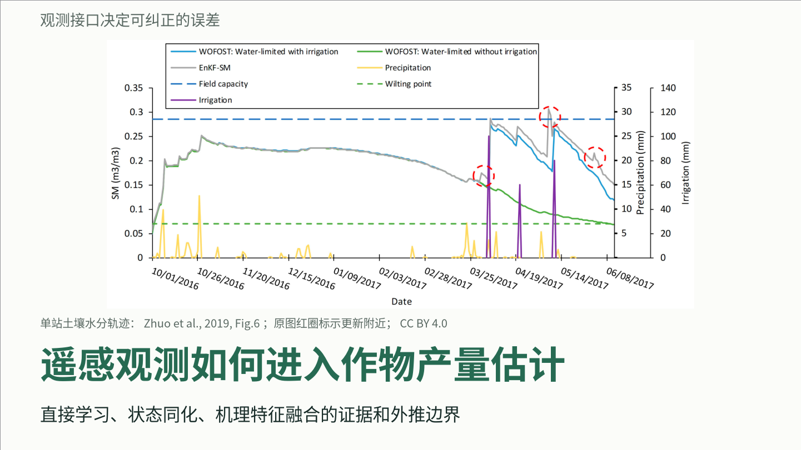
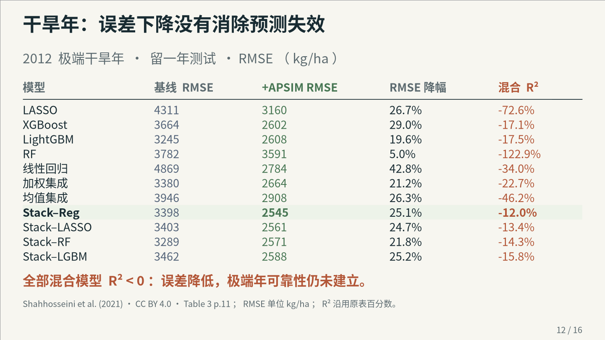
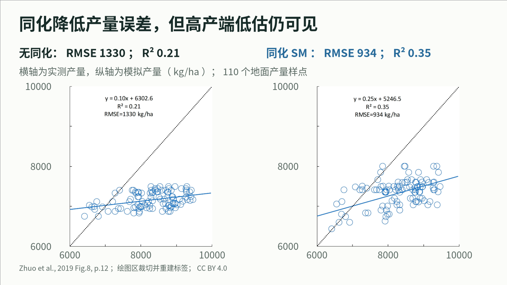

# dsh-academic-ppt · v0.7

**面向正式学术汇报的 DeepSeek Harness 插件：围绕研究问题组织证据，按内容设计页面，交付可编辑 PPTX、实际预览与可恢复工程。**

适用于论文精读、文献综述、研究进展、开题、学位答辩和项目汇报。v0.7 将原文图表盘点、参考学习、真实设计候选、自由原生构图和逐页复核连成完整工作流，重点改善内容稀疏、卡片阵列重复、科学关系表达不清与主视图小字的问题。

[**下载 v0.7.0**](https://github.com/YuZhou0311/dsh-academic-ppt/releases/tag/v0.7.0) · [安装与升级](docs/INSTALL.md) · [真实论文成稿](examples/research-native-v07/README.md) · [Release 说明](docs/releases/v0.7.0.md) · [验证记录](docs/VALIDATION_V07.md)

| 版本 | 运行要求 | 使用方式 |
| --- | --- | --- |
| **0.7.0** · renderer **11** · schemaVersion **1** | Node **`^22.19.0 || >=24.0.0`**；已配置的 DSH | 下载 Release 安装包，或检出 `v0.7.0` 标签 |

插件使用宿主已有模型，不另行调用付费模型或保存 DeepSeek 密钥；可与 [dsh-ppt](https://github.com/STARDUSTLC666/dsh-ppt) 共存。**尚未发布 npm**，请使用本仓库的 Release 或源码。设计质量仍依赖材料、当前模型和实际审阅；工具提供可组合的表达能力与明确检查。

## 先看成稿：三篇真实论文，两种报告组织方式

两位新上下文作者使用相同三篇正式论文，分别完成 **16 页**和 **15 页**报告，各有 **14 分钟讲稿预算**。下面展示最终 PPTX 的实际渲染；完整包包含全部 31 页 PNG、PDF、逐页讲稿、来源、候选与可重建记录。

| A：信息进入位置与外推边界 · 16 页 | B：观测接口与可纠正误差 · 15 页 |
| --- | --- |
| [PPTX](examples/research-native-v07/a/report.pptx) · [PDF](examples/research-native-v07/a/report.pdf) · [全稿概览](examples/research-native-v07/a/overview.png) | [PPTX](examples/research-native-v07/b/report.pptx) · [PDF](examples/research-native-v07/b/report.pdf) · [全稿概览](examples/research-native-v07/b/overview.png) |
|  |  |

**主视图保留足够的研究信息。** A 的极旱年结果页保留全部 11 个模型、误差变化和负 R²；B 的同化页保留原始散点，并放大坐标、单位与比较条件。

| A：完整模型比较 | B：原始散点与可读坐标 |
| --- | --- |
|  |  |

两份初稿曾使用相近封面，跨稿检查与实际并列复核后，B 重新设计。候选、拒选理由和返工记录均公开。两稿未使用固定模板编号；最终全部 31 页由作者实际打开并逐页查看。科学复核对照原始图表检查 **249 个结果数值**，5 项必须修正已关闭。[查看制作过程、科学复核与限制](examples/research-native-v07/README.md)

## v0.7 改变了什么

| 制作环节 | v0.7 的具体能力 |
| --- | --- |
| 从论文到页面 | 先盘点原图、数据表、实验条件、负结果和结论边界，再安排主证据、解释与阅读顺序。`contentChecks` 核对主要视图中的指定条件和数字，讲稿与引用不能替代正文。 |
| 学习参考 | `reference-guided` 学习主辅比例、分组方式、图文邻接、对齐与全稿节奏，再为当前材料构图。只有用户明确要求沿用版式时使用 `template-faithful`。 |
| 自主构图 | `composition.regions` 与 `drawings` 支持自由区域、原生文本、形状、折线、箭头和登记图片；可隐藏区域标题、取消框底、设为零内边距。没有生图模型也能直接绘制 SVG/PPTX。 |
| 先比较真实方案 | `study` 接收 2–6 个实际绘制的候选，输出 SVG、PPTX、并列 HTML 与可选真实渲染。封面和困难证据页可先看图再选，不只保存一段设计描述。 |
| 封面与完整标题 | `heading` 可指定题名位置、字号和完整断行；长标题按实际行高留出正文空间。自定义封面、结尾与逐页 `chrome` 支持按用途安排题名、身份、页码和章节。 |
| 科学关系与阅读层级 | 语义色、线型、字号与分组由作者按研究关系配置；新工程默认正文／标签／注释为 **28／24／18 CSS px**（21／18／13.5 pt），检查最终缩放后的字级。 |
| 卡片按关系设计 | 卡片可自定轮廓、浅底、实底、圆角、内边距、强调边与语义图标；面板与局部解释分别设计。开放标注、题签与卡片可按内容组合。 |
| 全稿与跨稿复核 | 保留内容占幅、未使用大块空间和稿内重复检查；`portfolio` 比较明确指定的 2–12 份工程，返回需要并列查看的页对。换字、换色、换数据值不算构图变化。 |
| 来源和内容完整性 | 自绘图像、数据标记与结论保持来源关联；遗漏的图、表、节点、绘图或书目会被报告，不能在排版时静默丢失。 |

完整字段、约束和例子见 [自由原生构图说明](docs/RESEARCH_NATIVE_DESIGN.md)。原生绘图的语义与连线由作者声明，检查不能代替科学判断；`portfolio` 提供结构线索，不提供原创性分数。

## 推荐的制作流程

1. **确定汇报问题。** 明确听众、时长、论文范围和研究问题，完整阅读实际需要的来源。区分原文报告的事实、汇报者推断和待验证方案。
2. **盘点证据。** 记录可用原图、数据、方法关系、比较条件与负结果。需要进入主要视图的信息先确定，再决定页数和构图。
3. **研究参考并确定视觉方向。** 从实际页面学习信息密度、层级、对齐、分组和节奏，保存本稿的设计理由。颜色、箭头和线型应有稳定含义。
4. **完成真实候选。** 先设计不同封面及困难证据页，用 `study` 导出并查看；比较主证据尺度、关系是否清楚、信息是否完整和标题是否专业。
5. **展开全稿。** 按本页任务使用原图分析、数据比较、方法关系、证据综合等构图。连续实验需要同尺度比较时，可以有意复用结构。
6. **核对并交付。** 检查证据、来源、字号与几何，实际渲染当前 PPTX，逐页看图；同时看全稿概览，必要时跨稿对照。修正后重新构建、渲染和登记审阅。

密集论文图应按阅读任务放大、拆页或选取经核对的局部视窗，同时保留坐标、单位、对照和图例。主视图需要可读的中间字级；详细推导可放讲稿或附录，关键限定仍要出现在页面上。

## 安装与升级

### 推荐：下载正式安装包

从 [v0.7.0 Release](https://github.com/YuZhou0311/dsh-academic-ppt/releases/tag/v0.7.0) 下载 **[dsh-academic-ppt-0.7.0.tgz](https://github.com/YuZhou0311/dsh-academic-ppt/releases/download/v0.7.0/dsh-academic-ppt-0.7.0.tgz)**，在已经初始化的 DSH profile 中，用自己机器上的真实绝对路径安装：

```sh
dsh plugin --profile desktop add "file:/absolute/path/to/dsh-academic-ppt-0.7.0.tgz"
```

网页版将 `desktop` 换成 `web`。安装后启用插件并重启相应 DSH；升级 `file:` 包同样需要重新安装和重启。安装包由 DSH 包管理器解析依赖，不能将其解包后直接套用下面的源码 `npm ci` 流程。[Windows、字体与升级说明](docs/INSTALL.md)

### 源码安装与开发

```sh
git clone --branch v0.7.0 --depth 1 https://github.com/YuZhou0311/dsh-academic-ppt.git
cd dsh-academic-ppt
npm ci --ignore-scripts
node bin/academic-ppt.mjs --help
dsh plugin --profile desktop add "file:/absolute/path/to/dsh-academic-ppt"
```

普通 PPTX/HTML 生成不需要 Microsoft Office。实际 PPTX 图片/PDF 渲染使用可选的官方 `@deepseek-ai/libreoffice-kit`；可通过 `fontDirectories` 提供工作区内有许可的中文字体。缺少引擎或字体时会保留未验证状态，HTML/SVG 预览不能替代最终 PPTX 的实际渲染。

### 可直接使用的任务指令

> 使用 dsh-academic-ppt，依据我提供的真实论文和数据制作 12 分钟正式学术汇报。先盘点原图、数据表、实验条件、负结果与结论边界，建立中心问题和证据链。参考页面的主辅比例、局部分组、图旁解释、阅读层级和全稿节奏，为当前内容自行设计。先实际绘制两个不同封面和两个困难证据页候选，用 study 导出并看图选择；没有生图模型就用原生绘图。主视图保留完整比较、关键条件和可读中间字级；颜色与连线表达真实研究关系。封面、每页标题和结尾都要设计，页面按研究任务变化。完成后查看最终 PPTX 的每一页，与原文核对，交付可编辑文件、实际预览、讲稿与可恢复工程。

论文数量、全文范围、期刊要求、汇报时长与材料来源以你的任务为准。恢复中断任务时提供 `project.json` 路径，使用 `academic_ppt_context` 读取已有记录后继续。

## 交付文件与可编辑范围

每次构建保存新的输出目录；工程保存在 `project.json`，来源、论点、资产、设计与页面记录可继续修改。

| 文件／对象 | 用途与范围 |
| --- | --- |
| `report.pptx` | 可编辑演示稿；文本、形状、关系线及支持的原生图表可继续修改。论文原图内部仍为位图。 |
| `report.html` 与 SVG | 快速浏览构图；用于设计预览。 |
| 实际 PDF／逐页图片／概览 | 从当前 PPTX 渲染，供逐页和全稿审阅；需要可用的渲染引擎与字体。 |
| `speaker-notes.md` 与 PPTX 备注 | 完整讲稿、推导说明和时间预算。 |
| `evidence.json`、`asset-manifest.json`、`quality.json` | 保存来源关系、资产摘要、检查结果与诊断。 |
| `project.json` | 恢复、局部修改与重新导出的工程记录。Office 手改不会自动回写此文件。 |

这两份 v0.7 示例的数表、数据标记和关系线由**可编辑原生形状**构成，并非 Office table/chart 对象。插件支持的其他图表类型及局部修改边界见 [组合页与科学图](skills/dsh-academic-ppt/references/composition.md) 和 [修改规则](skills/dsh-academic-ppt/references/revision.md)。

### 离线重建公开示例

在源码目录完成依赖安装后，使用新的输出目录：

```sh
node scripts/build-research-demo.mjs --author a --output ./research-demo-a
node scripts/build-research-demo.mjs --author b --output ./research-demo-b
```

需要实际渲染时加 `--render --font-dir ./fonts`。重建入口校验来源摘要，通过公开 API 重放作者记录，不请求模型或网络；这是记录重放，不计作新的独立制作，也不继承旧稿的视觉审阅。[文件、来源与核验范围](examples/research-native-v07/README.md)

## 十四个工具

| 工具 | 作用 |
| --- | --- |
| `academic_ppt_init` | 创建研究问题、听众、时长与证据条件明确的工程 |
| `academic_ppt_contract` | 按需获取 brief / paper / claim / asset / slide / design / assessment 精确契约 |
| `academic_ppt_record` | 从工作区 JSON 文件登记有类型的研究与页面批次 |
| `academic_ppt_context` | 读取阶段、待解决问题与聚焦记录 |
| `academic_ppt_template` | 研究参考模板，取得设计变量、结构依据及可选实际渲染 |
| `academic_ppt_reference` | 查询 48 个中性参考页型或图片适配候选 |
| `academic_ppt_study` | 生成实际候选 SVG/PPTX、并列预览和可选真实渲染 |
| `academic_ppt_portfolio` | 比较明确指定的不同工程结构与封面 |
| `academic_ppt_build` | 预检后生成 PPTX、HTML、讲稿与来源材料 |
| `academic_ppt_edit` | 按页面或卡片范围执行局部修改 |
| `academic_ppt_undo` | 以新修订恢复上一内容状态 |
| `academic_ppt_render` | 渲染当前实际 PPTX，保存逐页图片、概览与回执 |
| `academic_ppt_check` | 核对证据、几何、成品一致性与审查范围 |
| `academic_ppt_review` | 为当前产物哈希登记实际完成的逐页观察 |

写入操作使用当前 `expectedRevision`；每批最多 5 个来源、20 条 claim、8 个资产、8 页，记录文件不超过 1 MiB。DSH 常驻工具采用有界文件路径参数，详细契约按主题读取。[完整安装与接口使用](docs/INSTALL.md)

## 已验证什么

v0.7.0 将已经完成的 rc.4 重建整理为正式版本，**renderer 11 与 schemaVersion 1 保持不变**。真实论文试用与科学审查保留原来的日期、版本和范围。

| 验证 | 已完成范围 |
| --- | --- |
| 软件回归 | 291 项通过，0 失败、0 跳过；覆盖契约、原生构图、来源与数值、字号、编辑、候选隔离、跨稿比较和兼容性。 |
| 实际成稿 | 两次新上下文作者任务，共 31 页最终实际渲染，作者逐页查看；A 为 0 错误／7 提醒，B 为 0 错误／6 提醒。 |
| 科学复核 | 249 个结果数值与原始图表对照；5 项必须修正已关闭，具体修订与审阅范围有记录。 |
| 离线重建 | 两稿均可从公开记录重建；每稿检查的 24 个 slide XML 与 media 部件一致。完整 PPTX ZIP 会因新构建元数据产生不同哈希。 |
| 包与文档 | 十四个工具、48 种参考页型、9 个参考 PPTX 摘要、运行入口及文档本地链接接受检查。 |

这里的两次真实作者试用与十份合成结构测试分别计数，不声称制作了十份真实独立报告。部分论文原图的次级标签仍偏小，关键数值、单位和条件已用较大原生文字呈现；现场投影、PowerPoint/WPS GUI 与用户的 DSH／DeepSeek 环境尚未完成验收。时间是讲稿预算，未做真人计时排练。

`readyForDelivery` 汇总当前证据记录、构建、渲染、字体与具名审阅状态，不是科研真实性或审美评分。完整依据见 [v0.7 验证记录](docs/VALIDATION_V07.md) 与 [示例审阅材料](examples/research-native-v07/review/)。

## 文档与历史记录

- [安装、更新与故障排查](docs/INSTALL.md)
- [自由原生构图、标题、字号、study 与 portfolio](docs/RESEARCH_NATIVE_DESIGN.md)
- [参考模板的学习方法](skills/dsh-academic-ppt/references/template-learning.md)
- [v0.7.0 Release 正文](docs/releases/v0.7.0.md) 与 [完整版本历史](docs/RELEASE_NOTES.md)
- [v0.6 材料进展示例](examples/materials-v06/README.md)、[v0.5 材料示例](examples/materials-v05/README.md) 与 [理论精读历史预览](examples/theory-v05-preview/README.md)
- [历史设计依据](docs/DESIGN_REFERENCES.md) 与 [旧 48 页参考库](skills/dsh-academic-ppt/references/templates/README.md)

历史成稿、失败与审查记录保留原版本身份；它们不计入新版制作次数。

## 许可与来源

代码采用 [MIT](LICENSE)。本项目参考 dsh-ppt 的插件与可选渲染实践，说明见 [THIRD_PARTY_NOTICES.md](THIRD_PARTY_NOTICES.md)。论文、图片、用户模板和字体遵循各自许可；本次三篇公开论文的署名、出处、图件修改与 CC BY 4.0 声明见 [示例来源](examples/research-native-v07/sources/README.md)。用户上传的完整源模板、会话日志与其中研究资料不随公开包分发。
