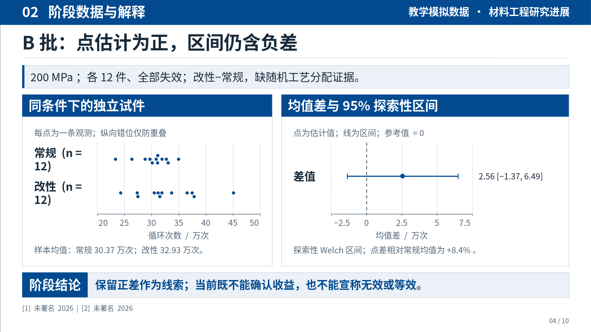

# dsh-academic-ppt

**面向正式学术汇报的 DeepSeek Harness 插件：先完成研究论证，再用模板的设计语法组织可编辑 PPTX。**

适用于论文精读、文献综述、研究进展、开题、学位答辩和项目汇报。研究问题、原始证据、解释边界和验证方案保存在可恢复工程中；文字、机制图、表格与支持的图表使用原生对象，论文原图独立保留。

当前源码版本 **0.5.0**。安装包发布入口见 [Releases](https://github.com/YuZhou0311/dsh-academic-ppt/releases)。尚未发布 npm。插件使用当前 DSH 会话的模型和工具，不另行调用付费模型，也不管理 DeepSeek 密钥。可与 [dsh-ppt](https://github.com/STARDUSTLC666/dsh-ppt) 共存。

[安装与升级](docs/INSTALL.md) · [为什么重做 v0.5](docs/AUDIT_V05.md) · [验证范围](docs/VALIDATION.md) · [版本说明](docs/RELEASE_NOTES.md) · [学术执行技能](skills/dsh-academic-ppt/SKILL.md) · [设计与边界](docs/DESIGN.md)

## 查看实际成稿

### 材料研究进展：C4 已获独立接受

这份10页报告由一个未继承本次聊天、旧产物或诊断的制作者，从原始教学协议、48件CSV数据、两份原始模板及封存插件独立完成。独立审稿者先重算原始数据，再查看全部10页实际画面，并核对完整讲稿、PPTX备注和分析说明，结论为**接受：0项阻断、0项必改、3项可优化**。600秒是讲稿预算，未做真人排练。[详细审稿记录](docs/MATERIALS_C4_REVIEW_V05.md)

[下载PPTX](examples/materials-v05/report.pptx) · [下载PDF](examples/materials-v05/report.pdf) · [完整讲稿](examples/materials-v05/speaker-notes.md) · [分析说明](examples/materials-v05/analysis-explanation.md) · [源记录](examples/materials-v05/deck.json) · [原始协议](examples/materials-v05/inputs/protocol.md) · [48件CSV](examples/materials-v05/inputs/fatigue.csv) · [分析与绘图源码](examples/materials-v05/analysis/)

**正式封面：研究主题、汇报场合与教学模拟身份直接呈现。**


**第4页证据：独立观测、均值差与不确定性在同页说明。**



还可查看 [第7页新试验方案](examples/materials-v05/previews/page-0007.png)、[全部10页概览](examples/materials-v05/overview.png)和[样例说明与文件清单](examples/materials-v05/README.md)。PPTX、PDF、讲稿、分析说明和页面保留封存字节，3项可优化建议未改入成品。第4页的点与区间可原生编辑；第3、5页科学图以PNG嵌入，另附SVG和源码。[前3轮材料失败与协议记录](docs/INDEPENDENT_REVIEW_V05.md)仍然保留，C4的接受不代表一次完成或所有学术任务的稳定成功率。

### 理论论文精读：12页已获独立接受

[理论精读实际预览](examples/theory-v05-preview/README.md)同样来自未继承旧产物或诊断的制作者，只收到原论文、两份原始模板、插件和普通制作任务。独立审稿者核对关键原文并实际查看全部12页后接受，保留5项可优化建议。最终代码重建的12张实际页面与原稿逐字节一致；预览没有经过主线程重排或修图。

可查看 [正式封面](examples/theory-v05-preview/page-0001-cover.png)、[秩对称性证明页](examples/theory-v05-preview/page-0004-rank-proof.png)、[Beta校准分析页](examples/theory-v05-preview/page-0008-beta-calibration.png)、[独立审查记录](docs/INDEPENDENT_REVIEW_V05.md)和[最终代码重建记录](docs/REBUILD_V05.md)。完整理论稿包含一张再分发许可未核实的作者原图，公开包只提供不含该图的指定页面。两类试用均不代表DeepSeek收费端点或真实DSH GUI的端到端验收。

## v0.5 改变了什么

用户否定了 v0.4 与理想模板的视觉差距。这一版继续重做模板应用与全页构图，保留原始证据、学术分析和交付约束。没有为某个学科写固定结论，也没有把主线程手工修好的样例当成独立制作成功。

| 实际问题 | 当前实现 |
| --- | --- |
| 看过模板却没有应用其设计 | template 返回可 record 的 suggestedDesign；封面、页眉、分区、配色与字号进入真实渲染 |
| 封面仍像普通介绍页 | framed / project 正式封面家族；场合、完整研究题名、责任主体和日期形成层级，身份缺失时不补造 |
| 正文反复使用等权文字卡 | academic 组合页按研究关系安排不等宽、不等高证据面板；支持条件条、章节和结论带 |
| 科学图不能直接表现不确定性 | 原生独立观测分布与显式区间图；支持同页多图，不连接独立排序值，不自动编造置信区间 |
| 方法与下一步只有备忘段落 | 显式阶段、分支、汇合、反馈和无向关联；边的科学含义由作者声明，排版不自动创造关系 |
| 图注、表格、流程挤出画面 | 面板按文字和载体最小需求分配空间；完整内容与字号保留，具体冲突在正式构建前报告 |
| 反复探索接口与打开模板增加开销 | 按主题读取契约，JSON 批次登记；模板可一次研究并真实渲染，返回编号概览；CLI 可查询单命令参数 |
| 自动检查被当成成品质量证明 | 当前PPTX实际渲染、逐页观察与源模板对照分开执行；完整回归不替代独立科学和视觉审查 |

旧 48 页参考库保留作补充。新组合页由内容组织，使用者不必先选模板编号再把材料挤进固定槽。历史 v0.4 示例保存在 [materials-v04](examples/materials-v04/README.md)，它是被继续改进的历史基线。

## 内容先于版式

每条研究结论区分三种身份：作者直接报告的 **reported**，汇报者据证据作出的 **inference**，尚待验证的 **proposal**。页面要解释证据为何支持结论、哪些条件仍未排除，不能只写“效果显著”“样本有限”“未来继续研究”。

理论论文可以记录定理条件、证明思路与反例；定性研究可以记录取样、分析方法与解释边界；项目进展可以记录数据、已完成工作和下一步验证。没有 DOI 的数据集、协议或项目材料不需要编造 DOI。数字保留基线、分母、单位与汇总方法，模拟资料持续标明模拟身份。

完整题名和书目始终保留；逐篇导读页仅在任务需要时使用。用户明确要求的全文、篇数和期刊条件仍然是门槛，不能为了让构建通过静默降低。

## 学习模板，保留学术表达

`academic_ppt_template` 保存 profile，返回 `suggestedDesign`、结构推断依据与不含旧正文的 `study`。启用 `render:true` 后同时取得源模板的实际页面和编号概览。执行者看封面、代表证据页和机制/密集页，再选择一个主模板。

将审定后的 suggestedDesign 写入 record 批次的 design，才能改变实际封面、页眉、分区与字号。仅调用模板工具或导入 components 不会建立完整报告设计。另一份模板可以提供研究关系的组织思路，全稿仍保持统一体系。推断报告说明来源页与适配边界，不声称无损克隆任意母版。[模板学习方法](skills/dsh-academic-ppt/references/template-learning.md)

正文用 `layout:academic` 与 `composition.rows` 分配证据面板；图、表、分布、区间和机制图各有明确归属，紧邻解释和最终判断形成推导。复杂统计图可由有来源的计算脚本绘制，再登记为作者自制资产。[组合页与科学图](skills/dsh-academic-ppt/references/composition.md)

保留的 [48 页教学参考库](skills/dsh-academic-ppt/references/templates/README.md) 覆盖论文、机制、实验、结果、原图、综合、局限与方案。默认查询提供中性结构，只有显式 `includeExamples: true` 才返回教学文件。教学 PPTX 是版本化布局示例，不是新项目已经通过质量验收的证明。

原图必须适合当前阅读任务。密集图不能只按外框尺寸缩进半栏；需要保留坐标、单位、对照和图例，必要时采用经核对的局部视窗或拆页。原图内部作者绘制的元素通常仍是位图，不虚构其可编辑性。[图片选择](skills/dsh-academic-ppt/references/figure-selection.md)

## 安装与首次使用

需要 Node **`^22.19.0 || >=24.0.0`**。从本仓库下载源码，或按[安装说明](docs/INSTALL.md)选定已发布版本：

```sh
git clone https://github.com/YuZhou0311/dsh-academic-ppt.git
cd dsh-academic-ppt
npm ci --ignore-scripts
node bin/academic-ppt.mjs --help
```

用自己机器上的真实绝对路径安装到已经初始化的 DSH profile：

```sh
dsh plugin --profile desktop add "file:/absolute/path/to/dsh-academic-ppt"
```

网页版把 `desktop` 换成 `web`。安装或更新后重启对应 DSH；`file:` 包的安装副本不保证随源码自动更新。尚未发布 npm，不要用裸包名从公共 registry 安装。

普通 PPTX/HTML 生成不需要 Office。实际 PPTX 图片/PDF 渲染使用可选官方 `@deepseek-ai/libreoffice-kit`；缺引擎或字体时如实返回未验证状态。可通过 `fontDirectories` 提供工作区内有许可的中文字体。

离线重建随包的[已接受材料C4示例](examples/materials-v05/README.md)：

```sh
npm run demo -- --output ./my-materials-demo
```

这会按当前学术规则创建新工程，不请求网络或模型，也不继承示例的视觉审查；用于核对安装和可编辑导出。新材料的内容分析仍由当前会话执行者完成。

本版已实际验证该入口：材料C4重建后的10张实际PPTX页面及讲稿均与封存原件逐字节相同，并对新产物重新完成逐页查看。[材料与理论的重建记录](docs/REBUILD_V05.md)

### 可直接使用的任务指令

> 使用 dsh-academic-ppt，依据我提供的论文、数据和参考模板，制作一场 12 分钟的正式学术汇报。先明确中心问题，分析方法如何工作、证据能支持什么、哪些解释尚未排除，再组织页序。学习模板的封面、标题层级、图文比例与对齐，不复制模板研究内容。先完成封面、最难证据页与机制或综合页的小样，再完成全稿。保留关键条件、完整书目和演讲备注；实际渲染最终 PPTX，逐页检查后交付可编辑文件及工程。

论文数量、IF、全文范围、材料来源和汇报时长均以用户任务为准。恢复中断任务时提供 `project.json` 文件路径，调用 `academic_ppt_context` 继续，不从头重复研究。

## 十二个工具

| 工具 | 作用 |
| --- | --- |
| `academic_ppt_init` | 创建研究问题、听众、时长与证据条件明确的工程 |
| `academic_ppt_contract` | 按 brief / paper / claim / asset / slide / design / assessment 获取精确契约 |
| `academic_ppt_record` | 从工作区 `recordsPath` 读取有类型的研究与页面批次 |
| `academic_ppt_context` | 读取阶段、待解决问题和聚焦记录 |
| `academic_ppt_template` | 返回可应用设计、结构依据与可选的实际模板页面/概览 |
| `academic_ppt_reference` | 查询 48 个中性布局，或取得最多三个图片适配候选 |
| `academic_ppt_build` | 预检后生成原生 PPTX、HTML、讲稿与来源材料 |
| `academic_ppt_edit` | 明确限定页面内容或小卡片样式的修改范围 |
| `academic_ppt_undo` | 以新修订恢复上一内容状态 |
| `academic_ppt_render` | 渲染当前实际 PPTX、生成编号概览并保存回执 |
| `academic_ppt_check` | 核对证据结构、几何、成品与审查范围 |
| `academic_ppt_review` | 为当前哈希登记实际完成的逐页观察 |

写入类操作使用当前 `expectedRevision`。每批最多 5 个来源、20 条 claim、8 个资产、8 页，JSON 批次不超过 1 MiB。DSH 注册的 record 参数只含工程路径、修订号与记录文件路径；CLI/core 保留内联兼容入口，完整验证相同。首次写某类内容先取该主题契约，不必每轮加载所有字段。

## 交付与修改

工程保存于 `project.json`。每次构建写入新输出目录，包含 `report.pptx`、`report.html`、`speaker-notes.md`、`evidence.json`、`asset-manifest.json`、`quality.json` 和 SVG 预览。可选真实渲染另存 PDF/图片与回执。

`card-style` 只允许更改目标卡片的样式、颜色和受支持组件，保护文字、数字、外框、其他场景对象和备注。内容与版式变更使用 `slide-content`，移除旧可选布局字段使用明确的 `removeFields`。Office 手改不会回写 JSON；新构建保留已有文件，不提供任意第三方 PPTX 的无损往返。

## 验证范围

当前确定性回归、封存候选、无上下文独立制作、实际页面及科学复核分别记录于 [VALIDATION.md](docs/VALIDATION.md)。旧版本的审查与成品保留历史身份，不继承为 v0.5 验收。

**尚未在用户的 DeepSeek 账户和真实 DSH Desktop/Web 中完成收费端到端对照试验，也未完成 PowerPoint/WPS 全平台显示验收。** 工具定义字节减少不等于同比账单下降；本版不报告没有测量过的人民币节省或稳定成功率。

`readyForDelivery` 是当前学术记录、无已知阻断、review 构建、真实渲染、字体状态和具名逐页审查的过程汇总。它不是科研真实性或审美评分，不能替代内容评审和目标设备检查。

## 许可与来源

代码采用 [MIT](LICENSE)。本项目参考 dsh-ppt 的插件与可选渲染实践，保留来源见 [THIRD_PARTY_NOTICES.md](THIRD_PARTY_NOTICES.md)。论文、图片、用户模板和字体遵循各自许可；用户上传的完整源模板、会话日志和其中研究资料不随公开包分发。
