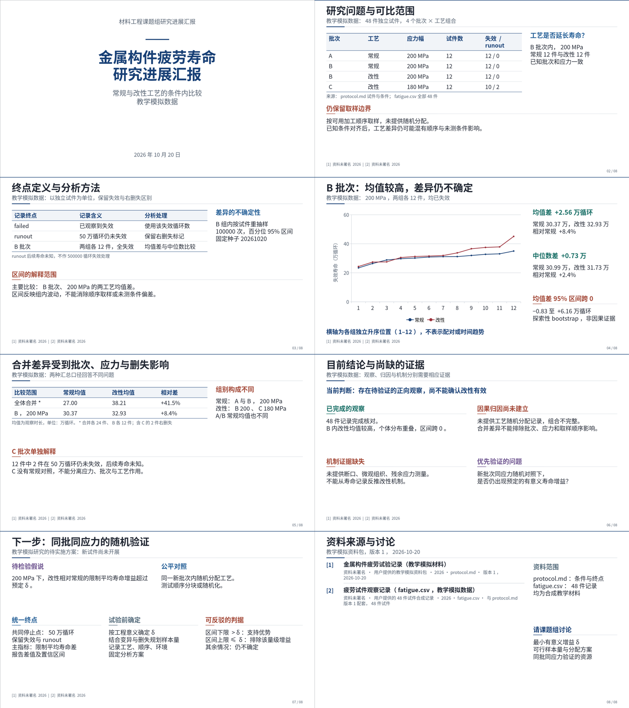

# dsh-academic-ppt

**面向正式学术汇报的 DeepSeek Harness 插件：先完成研究论证，再用模板的设计语法组织可编辑 PPTX。**

适用于论文精读、文献综述、研究进展、开题、学位答辩和项目汇报。研究问题、原始证据、解释边界和验证方案保存在可恢复工程中；文字、机制图、表格与支持的图表使用原生对象，论文原图独立保留。

当前版本 **0.4.0**。源码与版本包在本仓库发布，尚未发布 npm。插件使用当前 DSH 会话的模型和工具，不另行调用付费模型，也不管理 DeepSeek 密钥。可与 [dsh-ppt](https://github.com/STARDUSTLC666/dsh-ppt) 共存。

[安装与升级](docs/INSTALL.md) · [本轮问题审计](docs/AUDIT_V04.md) · [验证范围](docs/VALIDATION.md) · [版本说明](docs/RELEASE_NOTES.md) · [学术执行技能](skills/dsh-academic-ppt/SKILL.md) · [设计与边界](docs/DESIGN.md)

## 当前版本的实际成品

[8 页可编辑 PPTX](examples/materials-v04/report.pptx) · [同版 PDF](examples/materials-v04/report.pdf) · [讲稿、输入与可复算分析](examples/materials-v04/README.md) · [两个学科的独立试用记录](docs/forward-review-v0.4.0.md)



这个例子使用本轮新建的教学模拟数据，展示如何处理批次/应力混杂、右删失、比较区间与下一步验证；不对应真实实验或用户研究。成品经过真实 PPTX 渲染与逐页检查，文字、图表和表格为原生对象。另一项理论论文试用检验了证明条件、方法机制与外推边界，原图许可未确认公开再分发，因此只公开验证报告和来源链接。

## v0.4 改变了什么

这次更新依据实际失败会话、19 页产物与两份共 39 页参考稿定位问题。没有针对农业关键词硬编码结论。

| 发现的问题 | 本版的具体改变 |
| --- | --- |
| 有阅读标记，却缺少可追问的分析 | 来源记录增加问题、缺口、机制、验证设计、独立单位、对照与效度；claim 必须写支持理由与边界，推断关联原始证据并讨论替代解释 |
| 正文只是介绍卡片的集合 | 每页先登记论证问题与贡献；按精读、综述、进展、开题、答辩区分叙事，不强制五篇文献或每篇一页导读 |
| 直接套模板的内容和标题 | 默认参考工具只返回中性槽位与空字段骨架；模板研究返回设计统计，不返回旧正文；有题签的参考布局必须由当前研究重新命名 |
| 封面像普通正文页 | 新增独立 formal / minimal 封面：45 pt 原生主标题、明确层级与真实身份信息；未知单位、作者与日期不自动补造 |
| 溢出和碰撞留到交付 | 在导出前阻断已发现的文字、指标、表格越界与语义区域碰撞；保留完整内容和字号，要求重排或拆页 |
| 书目挤满页脚、参考页重新编号 | 正文使用简短来源标签；完整题名、作者、版本与 DOI/URL 留在参考页和备注；跨参考页连续编号 |
| 修改已保存，却被宿主报成失败 | 修复 slide-content 返回 undefined 导致的 lossless JSON 错误；统一返回值边界，工程目录误传时给出准确提示 |
| 长会话与反复重试成本高 | 12 个工具的注册定义由约 42.3 KB 降到 12.9 KB；详细契约按主题读取，记录经工作区 JSON 批次提交；先验约三页，再完成全稿 |
| 旧页检查被当成最终版本验收 | 最终 PPTX 哈希绑定逐页观察；存在未解决 issue 不能登记 passed；原始全文/篇数/期刊要求不能靠改 brief 消除 |

上述检查证明的是结构完整性、来源关联、已知布局条件与执行记录。它们不独立证明论文事实、原创性或审美，模型仍须真实阅读和看图。

## 内容先于版式

每条研究结论区分三种身份：作者直接报告的 **reported**，汇报者据证据作出的 **inference**，尚待验证的 **proposal**。页面要解释证据为何支持结论、哪些条件仍未排除，不能只写“效果显著”“样本有限”“未来继续研究”。

理论论文可以记录定理条件、证明思路与反例；定性研究可以记录取样、分析方法与解释边界；项目进展可以记录数据、已完成工作和下一步验证。没有 DOI 的数据集、协议或项目材料不需要编造 DOI。数字保留基线、分母、单位与汇总方法，模拟资料持续标明模拟身份。

完整题名和书目始终保留；逐篇导读页仅在任务需要时使用。用户明确要求的全文、篇数和期刊条件仍然是门槛，不能为了让构建通过静默降低。

## 学习模板，保留学术表达

`academic_ppt_template` 保存原始 profile，并返回紧凑 `study`：画幅、实际放映顺序、可解析的字体继承、字号和颜色分布、标题位置、图表与箭头数量、候选页型及解析边界。该摘要不含模板旧正文、机构名称或研究数字。

执行者实际查看封面、章节页、证据页和密集页，再决定迁移哪些标题层级、图文比例、对齐与题签结构。参考稿中的占位文字、示例数字、模糊原图和已有碰撞不能继承。[模板学习方法](skills/dsh-academic-ppt/references/template-learning.md)

保留的 [48 页教学参考库](skills/dsh-academic-ppt/references/templates/README.md) 覆盖论文、机制、实验、结果、原图、综合、局限与方案。默认查询提供中性结构，只有显式 `includeExamples: true` 才返回教学文件。教学 PPTX 是版本化布局示例，不是新项目已经通过质量验收的证明。

原图必须适合当前阅读任务。密集图不能只按外框尺寸缩进半栏；需要保留坐标、单位、对照和图例，必要时采用经核对的局部视窗或拆页。原图内部作者绘制的元素通常仍是位图，不虚构其可编辑性。[图片选择](skills/dsh-academic-ppt/references/figure-selection.md)

## 安装与首次使用

需要 Node **`^22.19.0 || >=24.0.0`**。从本仓库下载源码，或按[安装说明](docs/INSTALL.md)选定已发布版本：

```sh
git clone https://github.com/YuZhou0311/dsh-academic-ppt.git
cd dsh-academic-ppt
npm ci --ignore-scripts
node bin/academic-ppt.mjs --help
```

用自己机器上的真实绝对路径安装到已经初始化的 DSH profile：

```sh
dsh plugin --profile desktop add "file:/absolute/path/to/dsh-academic-ppt"
```

网页版把 `desktop` 换成 `web`。安装或更新后重启对应 DSH；`file:` 包的安装副本不保证随源码自动更新。尚未发布 npm，不要用裸包名从公共 registry 安装。

普通 PPTX/HTML 生成不需要 Office。实际 PPTX 图片/PDF 渲染使用可选官方 `@deepseek-ai/libreoffice-kit`；缺引擎或字体时如实返回未验证状态。可通过 `fontDirectories` 提供工作区内有许可的中文字体。

离线重建随包模拟示例：

```sh
npm run demo -- --output ./my-materials-demo
```

这会按当前学术规则创建新工程，不请求网络或模型，也不继承示例的视觉审查；用于核对安装和可编辑导出。新材料的内容分析仍由当前会话执行者完成。

### 可直接使用的任务指令

> 使用 dsh-academic-ppt，依据我提供的论文、数据和参考模板，制作一场 12 分钟的正式学术汇报。先明确中心问题，分析方法如何工作、证据能支持什么、哪些解释尚未排除，再组织页序。学习模板的封面、标题层级、图文比例与对齐，不复制模板研究内容。先完成封面、最难证据页与机制或综合页的小样，再完成全稿。保留关键条件、完整书目和演讲备注；实际渲染最终 PPTX，逐页检查后交付可编辑文件及工程。

论文数量、IF、全文范围、材料来源和汇报时长均以用户任务为准。恢复中断任务时提供 `project.json` 文件路径，调用 `academic_ppt_context` 继续，不从头重复研究。

## 十二个工具

| 工具 | 作用 |
| --- | --- |
| `academic_ppt_init` | 创建研究问题、听众、时长与证据条件明确的工程 |
| `academic_ppt_contract` | 按 brief / paper / claim / asset / slide / design / assessment 获取精确契约 |
| `academic_ppt_record` | 从工作区 `recordsPath` 读取有类型的研究与页面批次 |
| `academic_ppt_context` | 读取阶段、待解决问题和聚焦记录 |
| `academic_ppt_template` | 研究用户模板设计语法，保存受支持的原生组件 |
| `academic_ppt_reference` | 查询 48 个中性布局，或取得最多三个图片适配候选 |
| `academic_ppt_build` | 预检后生成原生 PPTX、HTML、讲稿与来源材料 |
| `academic_ppt_edit` | 明确限定页面内容或小卡片样式的修改范围 |
| `academic_ppt_undo` | 以新修订恢复上一内容状态 |
| `academic_ppt_render` | 渲染当前实际 PPTX 并保存回执 |
| `academic_ppt_check` | 核对证据结构、几何、成品与审查范围 |
| `academic_ppt_review` | 为当前哈希登记实际完成的逐页观察 |

写入类操作使用当前 `expectedRevision`。每批最多 5 个来源、20 条 claim、8 个资产、8 页，JSON 批次不超过 1 MiB。DSH 注册的 record 参数只含工程路径、修订号与记录文件路径；CLI/core 保留内联兼容入口，完整验证相同。首次写某类内容先取该主题契约，不必每轮加载所有字段。

## 交付与修改

工程保存于 `project.json`。每次构建写入新输出目录，包含 `report.pptx`、`report.html`、`speaker-notes.md`、`evidence.json`、`asset-manifest.json`、`quality.json` 和 SVG 预览。可选真实渲染另存 PDF/图片与回执。

`card-style` 只允许更改目标卡片的样式、颜色和受支持组件，保护文字、数字、外框、其他场景对象和备注。内容与版式变更使用 `slide-content`，移除旧可选布局字段使用明确的 `removeFields`。Office 手改不会回写 JSON；新构建保留已有文件，不提供任意第三方 PPTX 的无损往返。

## 验证范围

本轮包括原会话审计、确定性回归、三份实际 PPTX 的 58 页对照，以及不同学科的独立制作试用；已完成项、具体缺陷与产物见 [VALIDATION.md](docs/VALIDATION.md)。历史 v0.3 示例与审查记录保留为历史材料，不冒充 v0.4 的成品。

**尚未在用户的 DeepSeek 账户和真实 DSH Desktop/Web 中完成收费端到端对照试验，也未完成 PowerPoint/WPS 全平台显示验收。** 工具定义字节减少不等于同比账单下降；本版不报告没有测量过的人民币节省或稳定成功率。

`readyForDelivery` 是当前学术记录、无已知阻断、review 构建、真实渲染、字体状态和具名逐页审查的过程汇总。它不是科研真实性或审美评分，不能替代内容评审和目标设备检查。

## 许可与来源

代码采用 [MIT](LICENSE)。本项目参考 dsh-ppt 的插件与可选渲染实践，保留来源见 [THIRD_PARTY_NOTICES.md](THIRD_PARTY_NOTICES.md)。论文、图片、用户模板和字体遵循各自许可；用户上传的完整源模板、会话日志和其中研究资料不随公开包分发。
