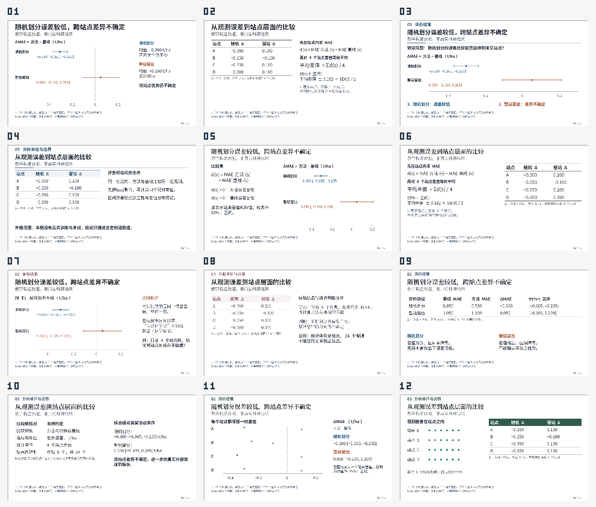

# dsh-academic-ppt

**把研究问题、真实证据和专业表达连起来，制作能够编辑、讲述和追问的学术汇报。**

**0.10.0-rc.1 候选版** · 19个DSH工具 · 6类可执行学术风格 · 原生可编辑PPTX

[研究依据](docs/RESEARCH_V010.md) · [风格样张](skills/dsh-academic-ppt/references/academic-styles/index.html) · [当前工作流](skills/dsh-academic-ppt/references/workflow-v010.md) · [验证与限制](docs/VALIDATION_V010.md) · [安装说明](docs/INSTALL.md)

本分支是候选代码，尚不表示已发布对应GitHub Release或npm包。既有正式版为 [v0.9.1](https://github.com/YuZhou0311/dsh-academic-ppt/releases/tag/v0.9.1)。候选源码可按下文构建本地安装包。

## 0.10 改变了什么

原有版本已经有证据追踪、故事板、真实PPTX渲染和逐页审查。本次主要解决Agent的设计注意力被卡片与表面效果牵引、默认紧凑密度迫使填充、风格变化维度不足的问题。

| 改动 | 实际行为 |
| --- | --- |
| **证据与论证成为主路径** | 先确定本页要判断什么、证据能支持什么，再选图表、方法关系和阅读次序；不先挑卡片填内容。 |
| **六类学术风格** | `styleProfile` 同时提供字体角色、标题/分组、导航、表格和配色默认；显式覆盖和用户模板优先。 |
| **开放科学排版** | 新稿以balanced和开放分组为起点。有意义的公式页、问题页和稀疏图可以留白；主体过小与无用空腔仍需审查。 |
| **参考学习按内容选择** | 可学习整页、科学图、学术风格或用户模板，无卡片整稿不用先读48卡；实际使用preset仍要查看该候选。 |
| **表格与字体职责独立** | 三线表、轻横线、色表头独立于panel；标题、正文和注释可以使用不同合适字族。 |
| **学术文案审稿** | 结果、方法、定义和问题采用适合的标题；删除空话与重复，保留条件、不确定性和负结果。 |
| **可重复检验** | 同内容风格样张、代码行为测试和固定Agent任务分别记录，避免把教学图册当成通用模型效果证明。 |

## 六种方向，按证据选择

| 方向 | 适用任务 | 重点 |
| --- | --- | --- |
| research-seminar | 会议、研讨、组会 | 开放大图、就近解释、轻导航 |
| thesis-defense | 答辩、开题、多工作汇报 | 章节定位、完整条件、研究链条 |
| methods-whiteboard | 理论、算法、模型与机制 | 假设、公式、符号和逐步推导 |
| paper-club | 论文精读、journal club | 原图面板、局部放大、作者结论与本人评议 |
| evidence-synthesis | 综述、证据比较、冲突结果 | 共同尺度、条件矩阵、三线表与边界 |
| field-report | 农业、生态、遥感、田间观察 | 地点、年份、处理与真实观察对应 |

每一份报告保持一套稳定的字体、数据色义和标注规则，页面随科学关系变化。同一实验的连续比较可以保持相同布局，不设置“至少几种版式”的配额，也不按页换风格。



[样张与可编辑PPTX](skills/dsh-academic-ppt/references/academic-styles/index.html)使用同一套可重算教学数据，**不是实际科研结果**。它们用于检查不同阅读关系、字体、表格和实际导出，不代表已经在所有DSH模型上取得同样效果。样张来源与检查范围见验证记录。

## 学术完整性继续保留

- 对主要主张记录来源、研究单位、指标、比较条件和边界；`reported`、`inference`、`proposal` 分开。
- 全文阅读、原图查看、元数据核对分别记录。下载成功和 `verified:true` 不代表完成研究。
- 原图保留轴、单位、图例、面板与比例尺。没有准确数据时不猜数重绘；生成图不能充当实验结果。
- 关键样本、对照、不确定性和限定在页面可见，不为了简洁降成小脚注。
- 用户参考中的旧人物、机构、数据和受限资产不自动进入当前研究或公开包。
- 最终交付继续核对当前PPTX、实际渲染、逐页审查、故事板和真实用户反馈/明确委托。

已有32种整页语法、48款局部卡片与20款局部参考继续兼容，作为需要时查阅的表达材料：[整页语法](skills/dsh-academic-ppt/references/page-recipes/index.html) · [卡片](skills/dsh-academic-ppt/references/card-library/index.html) · [局部组件](skills/dsh-academic-ppt/references/editorial-v083/index.html)。

## 从材料到成品

1. 确定听众、任务、时长、来源与设计方式，复用已知决定和授权。
2. 核实全文、图和数据，建立能够追问的证据与论证。
3. 写逐页故事板，按证据选择学术风格和阅读关系。
4. 先做真实困难页、封面与连续片段，实际渲染和审查，再确认方向。
5. 展开整稿，修复科学、读图、语言、几何与字体问题。
6. 展示修好的当前成品，按实际反馈或明确委托完成 `deliver`。

原有设计来源、故事线、真实样张、最终意见四个协作节点保留。已明确的事项不重问，一次充分的样张反馈可覆盖多个主题；明确委托只覆盖其真实范围，Agent不能代填批准。局部修改不重启整稿问卷。

## 使用示例

> 请使用dsh-academic-ppt，根据工作区的论文和实验材料做15分钟组会汇报。采用原创设计，重点说明研究问题、比较条件、关键结果与局限。请推荐适合证据的学术风格，先给故事线和真实困难正文样张。不要把所有页面做成卡片，不要用空泛金句替代读图。

如需自主完成，可明确补充：

> 故事线、配色、构图和最终审查均由你自主完成，保留我的科学要求。请实际渲染并逐页检查，修好问题后交付；无法核实的内容如实标明。

## 候选版开发与构建

```sh
npm ci
npm test
npm run check
node bin/academic-ppt.mjs contract --schema
npm run styles -- --output .test-output/academic-styles
npm pack
```

`npm pack`生成候选版本的本地TGZ；只在确认内容与版本后按 [安装说明](docs/INSTALL.md) 的本地包路径安装。这里没有对应已发布的0.10下载地址，也没有宣称已发布到npm registry。

插件使用宿主当前模型与工具，不读取模型API密钥，不自行调用付费模型。保留既有Host声明 `>=0.2.1-rc.2 <0.3.0-0`；本轮具体执行范围和未验证环节见 [验证记录](docs/VALIDATION_V010.md)，历史Host兼容记录见 [DSH_COMPATIBILITY.md](docs/DSH_COMPATIBILITY.md)。

## 研究、评测与许可

本次比较了公开PPT技能、科研沟通教程、科学图表研究和论坛实践，并独立实现。具体来源、适用边界与设计判断见 [研究说明](docs/RESEARCH_V010.md)。可用于同模型新会话对照的固定任务见 [evals](evals/README.md)。

本项目使用 [MIT许可](LICENSE)。已有第三方组件与素材的来源见 [THIRD_PARTY_NOTICES.md](THIRD_PARTY_NOTICES.md)。不能把自动检查通过、自评“专业”或教学样张解释成科研真实性认证或任意模型的效果保证。
