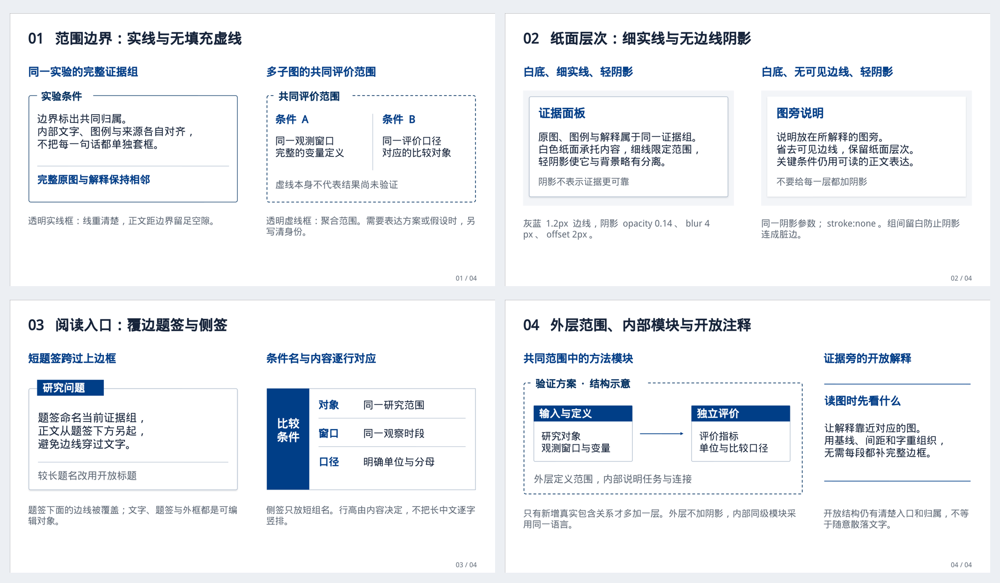
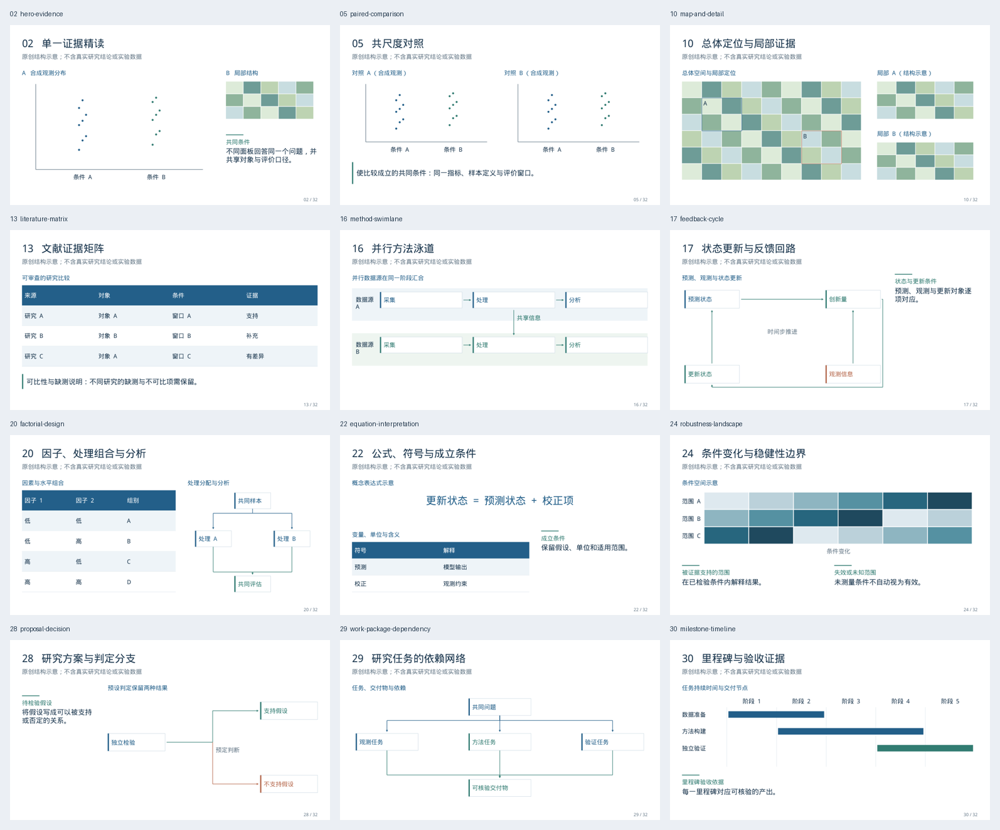

# dsh-academic-ppt

**用可追溯证据组织故事线，与用户一起看真实样张，制作能够继续编辑和正式讲述的学术汇报。**

**0.9.1** · 19 个 DSH 工具 · 32 种整页学术语法 · 48 种局部信息卡 · 可编辑 PPTX

[安装与升级](docs/INSTALL.md) · [0.9.1 发布说明](docs/RELEASE_NOTES.md) · [本次修复与验证](docs/VALIDATION_V091.md) · [Agent 接入核验](docs/AGENT_INTEGRATION_V090.md) · [迁移说明](docs/MIGRATION_V090.md) · [整页语法图册](skills/dsh-academic-ppt/references/page-recipes/index.html)

[下载 v0.9.1 安装包](https://github.com/YuZhou0311/dsh-academic-ppt/releases/download/v0.9.1/dsh-academic-ppt-0.9.1.tgz) · [正式 Release 与校验清单](https://github.com/YuZhou0311/dsh-academic-ppt/releases/tag/v0.9.1)。安装包、源码和清单绑定同一发布提交；GitHub Release 不表示已发布到 npm registry。

## 0.9.1 修复协作、卡片适配和深浅层次

v0.9.0 的协作节点仍可能被跳过：模板来源只在可选准备步骤出现，布局未进入独立主题，成品自查也没有收集最终用户反馈。与此同时，卡片与父面板会把剩余高度填满，短内容形成空腔。v0.9.1 将这些问题落实为运行时修复和新的实际渲染回归。

新版把论证计划、实际图像尺寸和最终交付连起来：

| 能力 | 具体行为 |
| --- | --- |
| **可审阅故事板** | 每页先写听众问题、主张标题、证据、推理、边界、转场和时间，再决定构图。关键原图和必须可见的条件会与实际导出逐项核对。 |
| **真实困难样张** | 批量制作前检查封面、最难正文和连续三页。样张确认绑定实际 PPTX、设计与证据；改变相关内容后重新复核。 |
| **整页布局语法** | 32 种语法覆盖不同学术关系，提供槽位、容量、适用条件和替代方案。作者可以重新分区或使用原创布局。 |
| **具体组件细读** | 查看原48卡、20组件及相关用户模板，记录真实边框、题签、间距与适配。透明虚线、细实线、独立阴影均有原生接口和可编辑参考，不靠浅色块代替层次。 |
| **真实用户协作** | 开场选择原创/模板参考/套版，再讨论故事线、实际样张的配色与布局风格、最终成品。委托须明确范围，未回答不能代填。 |
| **卡片自适应与留白自查** | 卡片按真实内容和区域测量，文本面板自然收紧，图槽按原图比例适配。逐页回应空腔、整页空区和对比风险，不能只写一个passed。 |
| **深浅层次** | 默认深色题签与白底正文；五套学术色板提供局部填色、深色重点面、中间色和开放证据区的可执行方案。 |
| **真实图像可读性** | 报告图框、实际图片、图注占高和投影标签大小。承担读数/对比任务的小图若未核实标签可读性，会阻断。 |
| **最终交付入口** | `deliver` 核验当前 review 构建、完整真实渲染、所有页面的当前自查、故事板及绑定当前成品和渲染的最终用户反馈。未解决问题继续修复，草稿不能通过此入口。 |

## 看清边框、纸面与题签，再决定如何使用



[视觉细节指南](skills/dsh-academic-ppt/references/academic-visual-language.md) · [四页可编辑PPTX](skills/dsh-academic-ppt/references/frame-studies/academic-frame-studies.pptx) · [细节图册](skills/dsh-academic-ppt/references/frame-studies/index.html)

无填充边界限定共同范围，白底细框与轻阴影承托证据，覆边题签给出阅读入口，开放注释依靠邻近与对齐保持归属。相同比较对象保持相同外观，任务变化时再改变结构。配色说明主次与色义，正文和来源仍保持可读；不按页轮换颜色或框型。

新checkpoints整稿达到六页计划时，需要可定位的`componentStudies`和`paletteRationale`。这些记录促使Agent写清看到了什么、准备怎样改造；不要求采用多少款卡，也不能代替实际看图与用户审美反馈。

## 看页面关系，不按模板轮播



图册只演示结构，不含真实科研结论、论文原图或用户商业模板素材。所有示意数字均为教学数据。实际报告需要替换为本次核实的证据。

[可编辑的32页语法示例](skills/dsh-academic-ppt/references/page-recipes/academic-page-recipes-32.pptx) · [交互图册](skills/dsh-academic-ppt/references/page-recipes/index.html) · [语法说明](skills/dsh-academic-ppt/references/page-recipes.md)

| 学术任务 | 可以采用的关系 |
| --- | --- |
| 说明问题与缺口 | 问题与证据、文献矩阵、已有能力与研究缺口、来源与论点映射 |
| 解释方法 | 方法管线、泳道、反馈回路、样本流、公式与变量解释 |
| 呈现实验设计 | 因子设计、实验分支与对照、机制与支持证据、跨尺度衔接 |
| 分析结果 | 大图精读、同尺度对照、前后与差异、多面板、图与精确表格、分布与不确定性 |
| 建立讨论 | 消融、稳健性、冲突结果、跨研究综合、局限与响应 |
| 提出下一步 | 条件决策、工作包依赖、里程碑、资源分配、回应开场问题 |

同一实验的共同尺度可以保持一致。新问题需要新的证据组织时再变构图。语法数量、图卡数量和空白占比都不是“优秀”的自动评分。

原有 [48款卡片](skills/dsh-academic-ppt/references/card-library/index.html)、[12种嵌图卡](skills/dsh-academic-ppt/references/image-cards.md) 和 [20款编辑式局部组件](skills/dsh-academic-ppt/references/editorial-v083/index.html) 继续可用，作为页面内部的表达材料。

## 用户参与的四个节点

1. **设计来源。** 默认原创设计，还是提供PPT参考？有模板时区分学习设计语法与保留具体版式。未知时先问并等待，已明确选择不重问。
2. **故事线。** 展示基于当前材料的中心问题、关键证据、顺序与取舍，让用户决定研究重点。
3. **真实样张。** 看封面、困难正文和连续三页，具体比较配色、深浅用量、布局、风格、卡片尺度与密度。一轮真实回答可以覆盖明确展示的多项选择。
4. **最终审查。** Agent先完成逐页自查和修复，再展示成品收集最后意见。接受或明确最终审查委托绑定当前PPTX与渲染清单哈希；自查通过不能代替用户反馈。

新工程使用 `consultation.workflowVersion:2`。普通“帮我做PPT”不是全权委托；`delegationTopics`只覆盖真实授权的主题。已有选择与范围明确的委托继续沿用，局部修改不重新启动整稿问卷。旧工程继续按原协议读取，准备既有工程时用 `existingProject:true`。

[完整工作流](skills/dsh-academic-ppt/references/workflow-v091.md) · [留白与深浅层次](skills/dsh-academic-ppt/references/space-and-tone.md)

## 学术完整性贯穿全程

- 主张对应真实来源、图表位置、数据口径与比较条件。`reported`、`inference`、`proposal` 分开登记。
- 全文阅读、实际看图和元数据核对分别记录。下载成功或 `verified:true` 不等于完成研究。
- 论文原图保留轴、单位、图例和必要对照。真实源图作为独立图片，说明、表格、形状和支持的数据图保持原生可编辑。
- 跨论文比较先核对研究对象、独立样本单位、时间、基线和指标。不可为了好看或凑版式制造显著性、因果箭头、效果量或总体地域判断。
- 用户模板用于学习层级、网格、分组、比例与节奏。原模板中的数字、机构、人物、Logo、图片与完整页面不会自动进入当前研究或公开发布包。

记录和静态检查能发现部分错误，不能代替真实研究判断。最终 PPTX 的渲染、逐页观察与相邻页节奏检查仍然必要。

## 从材料到交付

1. 先确定默认原创或用户模板，盘点目标、用途和材料，确认宿主的检索、PDF、图片输入与渲染能力。
2. 核实来源并取得实际图表，写出逐页故事板，用 `academic_ppt_plan` 保存。
3. 查询 `academic_ppt_layouts`，按内容选择整页关系；查看 `academic_ppt_cards`、局部组合与用户参考中的相关候选，细读边框、题签和间距，再选择preset或自主绘制。
4. 制作真实样张，实际渲染、查看、修复，记录方向选择或明确委托。
5. 扩展整稿，检查故事板兑现、图像可读性、学术限定、实际几何与全稿变化。
6. `build(review)` → `render` → 逐页 `review`，发现问题后编辑并重做相关检查。
7. 展示当前已修好的成品，记录真实最终意见或明确授权，再用 `academic_ppt_deliver` 生成新目录，包含 PPTX、实际 PNG/PDF、讲稿、证据、审查记录、可重建工程与 SHA-256 清单。

六页及以上整稿的最终交付必须有完整故事板和当前样张记录。短稿不为满足样张形式增加无用页面。旧工程继续支持读取、修改和预览，迁移方法见 [0.8.x 到0.9系列迁移说明](docs/MIGRATION_V090.md)。

## 开始使用

从 [v0.9.1 Release](https://github.com/YuZhou0311/dsh-academic-ppt/releases/tag/v0.9.1) 安装 `dsh-academic-ppt-0.9.1.tgz`，确认 DSH 插件详情显示 `0.9.1`，重启后在新会话中显式调用 `/dsh-academic-ppt`。安装入口支持固定版本下载地址或真实本地包路径。

> 请使用 dsh-academic-ppt，根据工作区论文和实验材料制作一份15分钟组会汇报。先问我默认原创还是参考模板，与我讨论故事线，再展示最难正文和连续三页的实际样张。我要学术严谨、内容充实、版式随问题变化；设计细节由你推荐。

明确委托时可补充：

> 你可以自主确定配色与构图，保留我的科学要求。你也可以自主完成最终审查与交付；请实际渲染并逐页检查留白、配色、证据和可读性，修好已发现的问题。

插件使用宿主当前模型与工具，不读取 API 密钥，不自行调用付费模型。没有生图能力仍可完成原生设计。DSH Host 声明范围继续为 `>=0.2.1-rc.2 <0.3.0-0`；实测边界见 [兼容说明](docs/DSH_COMPATIBILITY.md)。

## 开发与发布

```sh
npm ci
npm test
npm run check
node bin/academic-ppt.mjs --help
node bin/academic-ppt.mjs contract --schema
npm run layouts -- --output .test-output/page-recipes-demo
```

CLI、core API 和 DSH 工具使用同一验证逻辑。完整字段按需查询 `academic_ppt_contract`，不把所有 schema 和参考文档塞进每轮上下文。

发布脚本从一个已提交且干净的源码树构建 TGZ、源码 ZIP、说明、清单与校验和，排除未跟踪文件和历史传输目录。发布前应核对 [本次验证记录](docs/VALIDATION_V091.md)，不能仅凭版本号或静态测试声称任意模型都会产生优秀报告。

## 参考与许可

设计研究参考 [PPT-master](https://github.com/hugohe3/ppt-master) 的策划与最终质量关联、[Presenton](https://github.com/presenton/presenton) 的语义结构分离，以及 Anthropic 公开 PPTX 技能的文件/内容/画面分层验证。实现为本项目独立编写，具体机制、快照和许可边界见 [设计依据](docs/DESIGN_RATIONALE_V090.md)。

本项目使用 [MIT 许可](LICENSE)。第三方组件、开放科研图与署名见 [THIRD_PARTY_NOTICES.md](THIRD_PARTY_NOTICES.md)。
