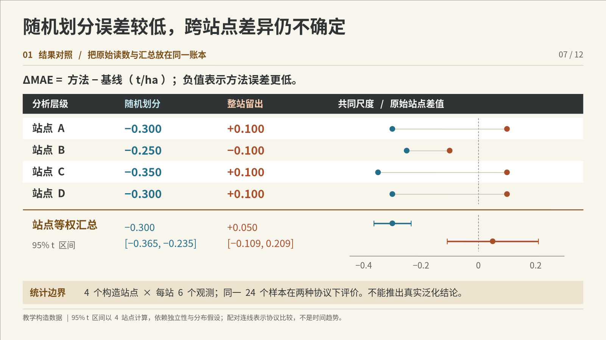

> **本地候选 0.10.0-rc.7**：自然高度方法图、独立题名/开场入口、共享尺度比较及具体构图诊断；保留rc6真实协作。不是已发布Release，也没有新的真实DeepSeek端到端质量结论。见 [RC7变更](docs/RELEASE_RC7.md) 与 [安装](docs/INSTALL_RC7.md)。

# dsh-academic-ppt

**0.10.0-rc.6 实测候选 · 19 个 DSH 工具 · 可编辑 PPTX · 科学证据与页面设计双轨**

让 Agent 按当前研究材料设计页面，而不是把内容填进固定卡片；先制作真实困难正文，查看实际 PPTX 渲染，逐页修正后再扩展。科学正确与视觉完成度分别检查，不以文件生成成功代替设计验收。

[安装与三页实测](docs/INSTALL_RC6.md) · [当前构图案例](skills/dsh-academic-ppt/references/design-cases/README.md) · [当前工作流](skills/dsh-academic-ppt/references/workflow-v010.md) · [本轮审计与边界](docs/AUDIT_RC6.md)

本包是本地审计后的完整候选，不是单独 SKILL 补丁，也未发布正式 Release 或 npm 包。请安装本轮提供的 `dsh-academic-ppt-0.10.0-rc.6.tgz`，不要用旧 0.9.1 / rc.1 包代替。当前修正尚未同步到远程主分支或原草稿 PR；本包源码与验证记录为本轮依据。

## 本次改动：恢复协作节点，保留视觉工艺

合并上一轮协作补丁为完整候选。Host 校验当前会话真实用户回答：自主构图不等于跳过样张/成品确认；预览发布后停止扩稿，否定反馈只能进入修订。短稿同样适用。样张确认绑定当前展示文件，不能拿旧认可覆盖新渲染；未变的已批样张不因新增正文误失效。

增加 `execution-identity-*.json`，记录实际插件版本、有效字体/页眉/配色、显式覆盖和逐页构图路径，不复制用户消息或密钥。本轮没有取得最新 DSH session，不能宣称已查明该次审美退化的执行原因。

保留 rc.5 的 compose-page 内容构图、structured/editorial/open 视觉层级、band/tab/rail/rule 题签、图注贴图、内容自适应高度和共享指标 comparison。它们仍需模型按材料作出设计判断，软件测试不证明审美。已给的参考、数据及文献沿用，不要求用户从头解释。

## 当前工作流

| 环节 | 当前行为 |
| --- | --- |
| 设计起点 | 用户参考和本页信息关系优先；六个 `styleProfile` 只是可覆盖基底，不代表六种已成熟的审美答案。 |
| 学习案例 | `contract(design).designCases` 返回实际单页 PNG 和对应设计解释的绝对路径。学主次、共享行、证据组、图文关系及迁移条件，不轮流套版。 |
| 原生创作 | 正常调用 `contract(authoring)` → `plan(compose-page)`。内容树编译到原生 drawings/composition；复杂关系仍可显式定制，不强迫整页模板。 |
| 能力判定 | 依据当前宿主真实 `read_image` 与渲染能力，不凭模型显示名或一张图片路径推定已经看图。 |
| 困难页 | 先用真实材料做方法/结果/多图页；短试作不凑封面，整稿仍检查故事板和困难页样张。 |
| 看图精修 | 工具可见摘要直接列出实际单页 PNG。分整页构图、证据整合、微排版检查；修订后重新渲染。 |
| 验收 | 当前 PPTX、渲染和逐页审查绑定；设计来源、故事线、样张、最终意见沿用真实回答或有范围的委托。 |

## 当前设计学习入口

内置八个原创教学页：四个结果页来自方向反馈较好的十二页版面实验；两个方法与多图组织教材；本轮再加共享比较修改示例及方法—验证视觉工艺示例。

| 案例 | 设计机制 |
| --- | --- |
| `shared-scale` | 共同尺度汇总图与精确读数并列 |
| `distribution-first` | 先理解站点分布，再读总体差异 |
| `evidence-ledger` | 对象、数值和图形共享行，减少来回寻找 |
| `evidence-stage` | 主图获得主体面积，原始读数作为支撑底栏 |
| `method-feedback` | 方法闭环与独立验证，连接必须有明确含义 |
| `paired-evidence` | 相关面板共享对象和阅读方向，比例服从信息 |
| `craft-shared-metrics` | 从逐段报数改为共享指标，弱例仅用于反面对照 |
| `craft-method-bridge` | 反馈主图与验证表的主次、题签与色面 |



[案例说明、实际渲染与输入](skills/dsh-academic-ppt/references/design-cases/README.md)包含适用条件、反例和换材料后的调整要求。都是教学构造数据，不能充当本次研究结果。八页没有携带用户上传稿件的原图、模板、Logo 或字体；另外八页不作为公共包素材。新增教材为构造示例，不代表用户认可；方法和多图任务仍需研究真实材料。

旧六类稀疏图册只保留作数据、可编辑性和兼容性测试，不再作为当前审美正样本。既有 32 种整页语法、48 款卡片及局部组件兼容保留，按需查阅，不要求逐一学习或全部采用。

## 从材料到成品

1. 核对任务、来源与已给参考；已知决定不重问，委托不扩大为对成品的认可。
2. 核对论文、数据和图，保留对象、比较条件、单位、不确定性与边界。
3. 故事线与构图一起规划，明确主证据、功能区关系、分组、对齐和色义；用 compose-page 提交内容关系。
4. 先做真实困难正文，实际渲染、逐页看图和修订，再展示候选供反馈。
5. 扩展整稿并复核连续段落；新文件不能沿用旧版本的审查记录。
6. 完成当前逐页审查及真实最终意见或明确委托后，才通过最终 `deliver`。

规则入口是 [SKILL](skills/dsh-academic-ppt/SKILL.md)，正文设计见 [美术指导](skills/dsh-academic-ppt/references/art-direction.md) 与 [逐页精修](skills/dsh-academic-ppt/references/page-polish.md)。自动检查不能替代模型实际看图或用户的审美判断；旁路审查脚本也不是自动美学评分器。

## 安装后先做三页迁移实测

安装完整 TGZ、启用插件，重启后**新建会话**。核对版本 `0.10.0-rc.6` 和工具返回的 `collaborative-proof-rc6`；只复制 SKILL 不会注册工具。详细桌面/Web路径和可直接使用的测试任务见 [实测指南](docs/INSTALL_RC6.md)。

第一轮先说明范围、主线和设计建议，待用户答复后做方法页、结果页、多图证据页；保留首稿与修订稿，展示后再次等待；不要运行案例构建脚本当作新报告，不直接扩展二十页后才看画面。当前插件沿用宿主的实际模型，不读取密钥、不自行调用付费模型、不擅自更换模型或思考档位。

## 开发与检查

```sh
npm ci
npm test
npm run check
node bin/academic-ppt.mjs --version
node scripts/check-installation.mjs
npm pack --ignore-scripts
```

可选实际渲染检查：

```sh
node scripts/check-installation.mjs --render --output /absolute/new-smoke-directory --font-dir /absolute/local-font-directory
```

不分发字体文件；使用合法本地字体并核对实际字形。`missingFonts=[]` 不是完整字重、字形或美学验证。

声明的 Host 范围仍为 `>=0.2.1-rc.2 <0.3.0-0`，Node 为 `^22.19.0 || >=24.0.0`。实际测试范围见 [审计](docs/AUDIT_RC6.md) 与 [rc.2历史记录](docs/validation/rc2/README.md)。真实 DSH 模型的指令遵循、视觉理解和自主创作质量、用户 Desktop/Web 安装及 PowerPoint/WPS 实机尚待实测；官方 Host 的预设 provider 接入检查不能替代这些验证。

## 历史依据与许可

[最初研究依据](docs/RESEARCH_V010.md)、[rc.1 历史验证](docs/VALIDATION_V010.md)和[固定评测任务](evals/README.md)保留，但不是 rc.6 的当前通过记录。历史安装入口见 [INSTALL](docs/INSTALL.md)，不要将其中旧包地址作为本候选地址。

本项目使用 [MIT许可](LICENSE)，第三方组件与素材来源见 [THIRD_PARTY_NOTICES](THIRD_PARTY_NOTICES.md)。教学样张、自动检查及模型自评都不是科研真实性或通用设计质量保证。
