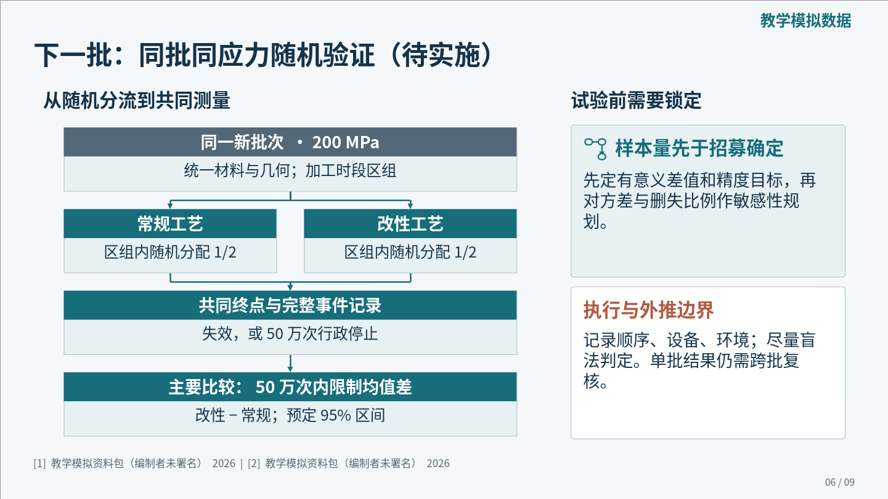
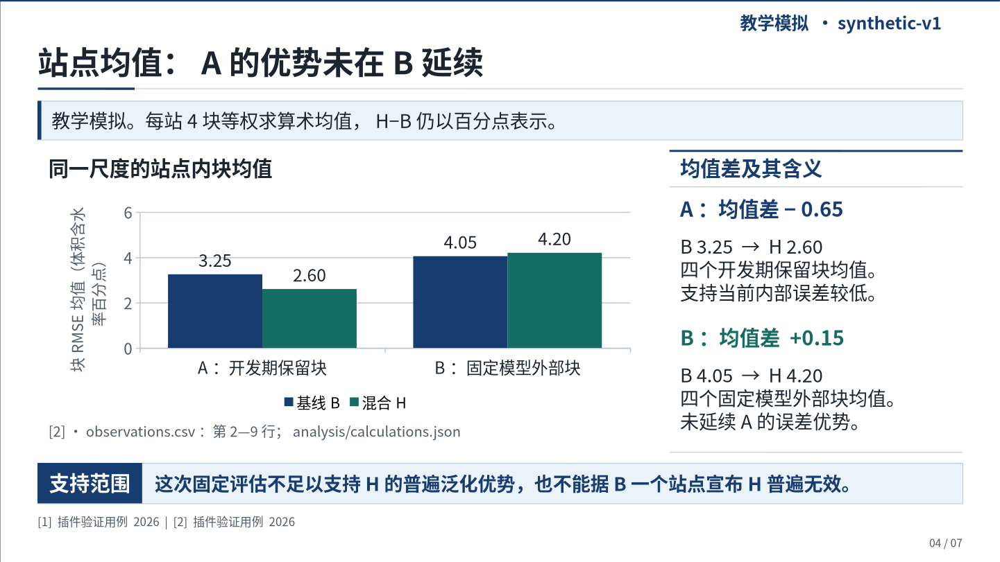

# dsh-academic-ppt

**面向正式学术汇报的 DeepSeek Harness 插件：先组织研究论证，再根据证据设计布局、图表与卡片，生成可编辑 PPTX。**

适用于论文精读、文献综述、研究进展、开题、学位答辩和项目汇报。研究问题、原始证据、解释边界和验证方案保存在可恢复工程中；文字、机制图、表格与支持的图表使用原生对象，论文原图独立保留。

当前重建版本为 **v0.7.0-rc.4，renderer 11**。这轮把流程改为原文图表盘点、参考组织方式、实际候选、自由原生构图与全稿复核，处理固定卡片阵列和大小字摘要之间反复摆动的问题。页面由当前会话模型设计；插件提供真实 SVG/PPTX 候选、可编辑对象和可解释的检查，不承诺一条提示词自动获得原创设计。

[本次重建分支](https://github.com/YuZhou0311/dsh-academic-ppt/tree/feat/research-native-rebuild)提供 rc.4 源码；[v0.6.0 发布页](https://github.com/YuZhou0311/dsh-academic-ppt/releases/tag/v0.6.0)保留旧稳定包和历史成稿。此前未上传的工作区已经丢失，本版从远端 v0.6 重新实现，不声称恢复旧提交。尚未发布 npm。插件使用宿主已有模型，不另行调用付费模型或管理 DeepSeek 密钥；可与 [dsh-ppt](https://github.com/STARDUSTLC666/dsh-ppt) 共存。

[安装与升级](docs/INSTALL.md) · [自由原生构图与实际候选](docs/RESEARCH_NATIVE_DESIGN.md) · [本轮验证](docs/VALIDATION_V07.md) · [版本说明](docs/RELEASE_NOTES.md) · [学术执行技能](skills/dsh-academic-ppt/SKILL.md) · [历史设计依据](docs/DESIGN_REFERENCES.md)

## 本次重构的目标与具体能力

充盈的学术页面需要主证据、辅助解释、研究条件和来源层级。参考学习包括主辅比例、局部分组、图文邻接和全稿节奏；当前内容决定图表、卡片、标题和页面结构。主视图需要可读的中间字级，不能只剩几句大字，也不能用小字填满空白。

| 能力 | 使用方式与边界 |
| --- | --- |
| 明确设计模式 | `content-led` 默认按内容设计；`reference-guided` 借鉴参考的视觉语言；`template-faithful` 用于用户明确要求沿用版式的任务 |
| 保存简短构图决策 | `slide.visualPlan` 记录信息关系、主面板、阅读顺序和选择理由；关键页可保存其他方案及取舍，便于复核 |
| 自行组织页面 | `composition.rows/regions` 与 `drawings` 支持自由区域及可编辑文本、形状、折线和箭头，无须先选择模板编号 |
| 先看真实候选 | `study` 输出2–6个作者实际绘制的SVG/PPTX候选和并列预览，可实际渲染；不修改原工程或冒充正式批准 |
| 专业标题与阅读层级 | `heading` 自定位置与完整题名断行；新默认主要正文28px、图标签24px、注释18px，检查缩放后的实际字级 |
| 必要条件保全 | `contentChecks` 检查正文中的指定条件与数字，讲稿和脚注不算；保留正负号、科学计数与单位大小写 |
| 原生小卡片与层次 | `design.cardDefaults` 与 `card.appearance` 可设计轮廓、浅底、实底、圆角、内边距、强调边与轻微阴影；`card.icon` 提供十种可编辑语义线图标 |
| 面板与卡片分别设计 | `panel.surface` 控制区域分组，卡片控制局部解释；按关系选择浅底、边界、题签或开放标注，避免机械阵列与多重套框 |
| 独立封面、结尾与页角 | 封面可用 `custom + boxes` 自主分配题名/身份/视觉区，也可选 `split/editorial`；`closing` 支持主判断、证据卡与讨论问题。`slide.chrome` 可逐页调整或删除无用品牌字、章节、页脚与标题线 |
| 检查大块空疏 | 新工程默认 `density:compact`；正文/结尾连续未使用区达到正文区四分之一、封面达到二分之一时阻断正式交付。背景、卡框、图标不能刷占幅，科学图内部留白不处罚 |
| 检查稿内与跨稿同质化 | `portfolio` 比较明确指定的不同工程，返回可并列的页对；换色、换字或改变数据值不算新构图，合理同尺度比较可保留 |
| 保留学术约束 | 事实、推断、方案分别登记，来源、单位、比较条件与结论边界仍需核对；构图自由不授权新增实验结果 |

完整字段与示例见 [本轮构图说明](docs/RESEARCH_NATIVE_DESIGN.md)，执行时按需读取 contract。历史机制参考与取舍见 [设计来源](docs/DESIGN_REFERENCES.md)；这些参考不是实际效果证明。实际试用与验证边界以 [本轮记录](docs/VALIDATION_V07.md) 为准。

## 本轮实际效果：三篇论文，两套完整报告

两位新上下文作者使用相同真实论文，分别完成 **16 页和 15 页**报告，各有 14 分钟讲稿预算。最终全部 31 页均实际渲染并逐页查看；原图、完整比较、研究条件、负结果和外推边界保留在主要视图。源码回归 **291 项通过**；科学复核对照原始图表检查了 **249 个结果数值**，发现的 5 项必须修正已关闭。[完整示例与验证范围](examples/research-native-v07/README.md)

| A：信息进入位置与外推边界，16 页 | B：观测接口与可纠正误差，15 页 |
| --- | --- |
| [PPTX](examples/research-native-v07/a/report.pptx) · [PDF](examples/research-native-v07/a/report.pdf) · [全部页面](examples/research-native-v07/a/overview.png) | [PPTX](examples/research-native-v07/b/report.pptx) · [PDF](examples/research-native-v07/b/report.pdf) · [全部页面](examples/research-native-v07/b/overview.png) |
|  |  |

两份初稿的封面仍撞了构图，跨稿检查和实际对照后，B 重新设计为上方真实轨迹、下方题名。候选、拒选理由和返工均有记录，终稿不宣称零干预独立成功。A 的完整 11 模型表和 B 的原始散点大字坐标展示不同的证据组织方式；这些数据载体均通过插件原生绘图完成。


两稿主要数值与条件使用可读原生文字，部分论文原图次级刻度仍偏小；未完成会场投影或用户 DSH／DeepSeek 环境验收。完整源记录、逐页讲稿、原始图源及审阅范围见 [示例说明](examples/research-native-v07/README.md) 和 [本轮验证](docs/VALIDATION_V07.md)。

## 历史 v0.6：9 页材料进展报告

以下示例保留 v0.6 的历史身份，不作为本轮重建的效果验收。

新上下文制作者只获得原始教学协议、48 行 CSV、普通任务和插件，没有旧稿、模板 PPT 或预先给定的结论。最终 9 页、9 分 15 秒预算，使用自定义封面、可见卡片、语义图标、原生数据图和关系流程；未使用固定模板编号。实际 PPTX 全部渲染并逐页检查，主线程另行复算数据与审阅画面，接受当前版本并保留可优化项。

[完整样例与边界](examples/materials-v06/README.md) · [可编辑 PPTX](examples/materials-v06/report.pptx) · [PDF](examples/materials-v06/report.pdf) · [讲稿](examples/materials-v06/speaker-notes.md) · [9 页概览](examples/materials-v06/overview.png) · [独立复核](examples/materials-v06/review/independent-review.json)



本例有 265 个原生形状、2 个表格、1 个原生图表和 9 页备注，没有图片对象。检查为 0 错误、2 项空间提醒，结尾与两项真实来源的书目页保留具体审查说明。两次运行补丁、制作返工与实际范围均公开记录；不声称一次成功、目标模型稳定成功率或零留白。

## 早期内容驱动试用（renderer 6，历史样例）

在本轮卡片与空间诊断重构之前，一个未继承当时诊断的执行者，用原始教学模拟协议和 8 行 CSV 完成了 7 页中文组会报告。5 个正文页自行组织组合布局，未使用固定模板编号；实际使用方法图、配对数据与差值分布、均值图、证据矩阵和后续判定表。作者及整理者均逐页查看了当时最终 PPTX 的真实渲染，并核对数据与讲稿。

[查看完整样例与边界](examples/content-led-v06/README.md) · [下载PPTX](examples/content-led-v06/report.pptx) · [全部7页概览](examples/content-led-v06/overview.png) · [讲稿](examples/content-led-v06/speaker-notes.md) · [本次验证记录](docs/VALIDATION_V06.md)

**主证据与解释按职责分配空间，保留比较条件和结论边界。以下是最终PPTX第4页的真实渲染。**



这份样例保留 renderer 6 的历史身份，**不验证本轮新增的原生卡片、chrome、封面/结尾与 compact 诊断**。它是一项单例宿主 agent 试用，制作中有修正，不代表真实 DSH / DeepSeek 的稳定成功率；模拟数据不代表现实研究。成稿与预览保留作者版本，未为展示效果另行重排或修图。

## 历史成稿与审查记录（v0.5）

以下成稿、截图与验收记录保留原来的 v0.5 身份，展示当时已完成的工作。它们不是 0.6 新提示词或新设计流程的效果验证。

### 材料研究进展：C4 已获独立接受

这份10页报告由一个未继承本次聊天、旧产物或诊断的制作者，从原始教学协议、48件CSV数据、两份原始模板及封存插件独立完成。独立审稿者先重算原始数据，再查看全部10页实际画面，并核对完整讲稿、PPTX备注和分析说明，结论为**接受：0项阻断、0项必改、3项可优化**。600秒是讲稿预算，未做真人排练。[详细审稿记录](docs/MATERIALS_C4_REVIEW_V05.md)

[下载PPTX](examples/materials-v05/report.pptx) · [下载PDF](examples/materials-v05/report.pdf) · [完整讲稿](examples/materials-v05/speaker-notes.md) · [分析说明](examples/materials-v05/analysis-explanation.md) · [源记录](examples/materials-v05/deck.json) · [原始协议](examples/materials-v05/inputs/protocol.md) · [48件CSV](examples/materials-v05/inputs/fatigue.csv) · [分析与绘图源码](examples/materials-v05/analysis/)

**正式封面：研究主题、汇报场合与教学模拟身份直接呈现。**


**第4页证据：独立观测、均值差与不确定性在同页说明。**


还可查看 [第7页新试验方案](examples/materials-v05/previews/page-0007.png)、[全部10页概览](examples/materials-v05/overview.png)和[样例说明与文件清单](examples/materials-v05/README.md)。PPTX、PDF、讲稿、分析说明和页面保留封存字节，3项可优化建议未改入成品。第4页的点与区间可原生编辑；第3、5页科学图以PNG嵌入，另附SVG和源码。[前3轮材料失败与协议记录](docs/INDEPENDENT_REVIEW_V05.md)仍然保留，C4的接受不代表一次完成或所有学术任务的稳定成功率。

### 理论论文精读：12页已获独立接受

[理论精读实际预览](examples/theory-v05-preview/README.md)同样来自未继承旧产物或诊断的制作者，只收到原论文、两份原始模板、插件和普通制作任务。独立审稿者核对关键原文并实际查看全部12页后接受，保留5项可优化建议。最终代码重建的12张实际页面与原稿逐字节一致；预览没有经过主线程重排或修图。

可查看 [正式封面](examples/theory-v05-preview/page-0001-cover.png)、[秩对称性证明页](examples/theory-v05-preview/page-0004-rank-proof.png)、[Beta校准分析页](examples/theory-v05-preview/page-0008-beta-calibration.png)、[独立审查记录](docs/INDEPENDENT_REVIEW_V05.md)和[最终代码重建记录](docs/REBUILD_V05.md)。完整理论稿包含一张再分发许可未核实的作者原图，公开包只提供不含该图的指定页面。两类试用均不代表DeepSeek收费端点或真实DSH GUI的端到端验收。

## v0.5 已有能力与历史改进

用户否定了 v0.4 与理想模板的视觉差距。v0.5 继续重做模板应用与全页构图，保留原始证据、学术分析和交付约束。[为什么重做 v0.5](docs/AUDIT_V05.md)记录了当时的问题与取舍。没有为某个学科写固定结论，也没有把主线程手工修好的样例当成独立制作成功。

| 当时的问题 | v0.5 的实现 |
| --- | --- |
| 看过模板却没有应用其设计 | template 返回可 record 的 suggestedDesign；封面、页眉、分区、配色与字号进入真实渲染 |
| 封面仍像普通介绍页 | framed / project 正式封面家族；场合、完整研究题名、责任主体和日期形成层级，身份缺失时不补造 |
| 正文反复使用等权文字卡 | academic 组合页按研究关系安排不等宽、不等高证据面板；支持条件条、章节和结论带 |
| 科学图不能直接表现不确定性 | 原生独立观测分布与显式区间图；支持同页多图，不连接独立排序值，不自动编造置信区间 |
| 方法与下一步只有备忘段落 | 显式阶段、分支、汇合、反馈和无向关联；边的科学含义由作者声明，排版不自动创造关系 |
| 图注、表格、流程挤出画面 | 面板按文字和载体最小需求分配空间；完整内容与字号保留，具体冲突在正式构建前报告 |
| 反复探索接口与打开模板增加开销 | 按主题读取契约，JSON 批次登记；模板可一次研究并真实渲染，返回编号概览；CLI 可查询单命令参数 |
| 自动检查被当成成品质量证明 | 当前PPTX实际渲染、逐页观察与源模板对照分开执行；完整回归不替代独立科学和视觉审查 |

旧 48 页参考库保留作补充。新组合页由内容组织，使用者不必先选模板编号再把材料挤进固定槽。历史 v0.4 示例保存在 [materials-v04](examples/materials-v04/README.md)，它是被继续改进的历史基线。

## 内容先于版式

每条研究结论区分三种身份：作者直接报告的 **reported**，汇报者据证据作出的 **inference**，尚待验证的 **proposal**。页面要解释证据为何支持结论、哪些条件仍未排除，不能只写“效果显著”“样本有限”“未来继续研究”。

理论论文可以记录定理条件、证明思路与反例；定性研究可以记录取样、分析方法与解释边界；项目进展可以记录数据、已完成工作和下一步验证。没有 DOI 的数据集、协议或项目材料不需要编造 DOI。数字保留基线、分母、单位与汇总方法，模拟资料持续标明模拟身份。

完整题名和书目始终保留；逐篇导读页仅在任务需要时使用。用户明确要求的全文、篇数和期刊条件仍然是门槛，不能为了让构建通过静默降低。

## 设计语言统一，页面按内容组织

没有参考模板时，直接采用默认 `content-led` 模式。先确定本页问题、主证据和阅读顺序，再组织构图。关键页可以比较两种方案并保存简短选择理由；相同实验的连续对照可以有意复用结构，无须为了求新而破坏可比性。

用户提供参考时，可调用 `academic_ppt_template` 保存 profile，取得 `suggestedDesign`、结构推断依据与不含旧正文的 `study`。`render:true` 同时返回源模板的实际页面和编号概览。查看代表页后，通常以 `reference-guided` 模式学习主辅证据、局部分组、图文邻接、层级和对齐方式，再为当前材料重新构图。模板页序、卡片数量与图文比例不自动成为要求。只有用户明确要求沿用版式时使用 `template-faithful`；它也不保证任意母版无损复刻。[模板学习方法](skills/dsh-academic-ppt/references/template-learning.md)

正文用 `composition.rows/regions` 或 `drawings` 分配证据与研究关系；图、表、分布、区间和机制图各有明确归属，紧邻解释和最终判断形成推导。`visualPlan` 记录这份构图的理由，不会自动重排页面。面板可使用 `inherit/plain/rule/tint/band` 表面，独立解释可通过 `appearance` 形成边界，也可用开放标注或题签，按局部关系选择。`align:start` 收紧局部后仍须处理剩余空间，不与同一面板的显式 `card.box` 或所消费机制节点的 `node.box` 混用。复杂统计图可由有来源的计算脚本绘制，再登记为作者自制资产。[组合页与科学图](skills/dsh-academic-ppt/references/composition.md)

封面先确定题名与主题视觉的关系，结尾重新收束判断、证据和待回答问题。标题、品牌字、章节、页码、页脚与顶部横线可独立选择；没有用途的元素可以删去并回收正文空间。全稿统一字体、语义色、线宽和间距，不要求每页重复同一套页眉或三卡结构。主题图片与图标承担识别、尺度或概念职责，不能冒充论文证据。[视觉设计与卡片语法](skills/dsh-academic-ppt/references/design.md)

保留的 [48 页教学参考库](skills/dsh-academic-ppt/references/templates/README.md) 覆盖论文、机制、实验、结果、原图、综合、局限与方案。默认查询提供中性结构，只有显式 `includeExamples: true` 才返回教学文件。教学 PPTX 是版本化布局示例，不是新项目已经通过质量验收的证明。

原图必须适合当前阅读任务。密集图不能只按外框尺寸缩进半栏；需要保留坐标、单位、对照和图例，必要时采用经核对的局部视窗或拆页。原图内部作者绘制的元素通常仍是位图，不虚构其可编辑性。[图片选择](skills/dsh-academic-ppt/references/figure-selection.md)

## 安装与首次使用

需要 Node **`^22.19.0 || >=24.0.0`**。本轮 rc.4 从重建分支取得；安装与更新见[安装说明](docs/INSTALL.md)：

```sh
git clone --branch feat/research-native-rebuild --depth 1 https://github.com/YuZhou0311/dsh-academic-ppt.git
cd dsh-academic-ppt
npm ci --ignore-scripts
node bin/academic-ppt.mjs --help
```

用自己机器上的真实绝对路径安装到已经初始化的 DSH profile：

```sh
dsh plugin --profile desktop add "file:/absolute/path/to/dsh-academic-ppt"
```

网页版把 `desktop` 换成 `web`。安装或更新后重启对应 DSH；`file:` 包的安装副本不保证随源码自动更新。尚未发布 npm，不要用裸包名从公共 registry 安装。

普通 PPTX/HTML 生成不需要 Office。实际 PPTX 图片/PDF 渲染使用可选官方 `@deepseek-ai/libreoffice-kit`；缺引擎或字体时如实返回未验证状态。可通过 `fontDirectories` 提供工作区内有许可的中文字体。

本轮两份真实论文报告可从作者记录离线重建到新目录：

```sh
node scripts/build-research-demo.mjs --author a --output ./research-demo-a
node scripts/build-research-demo.mjs --author b --output ./research-demo-b
```

入口校验来源摘要，通过公开 API 重放作者记录；不请求网络或模型，不继承原稿的视觉通过。实际渲染可加 `--render --font-dir ./fonts`。[文件、来源与重建说明](examples/research-native-v07/README.md)

也可运行随包的[v0.6 独立材料示例](examples/materials-v06/README.md)离线重建入口（历史 C4 可加 `--example materials-v05`）：

```sh
npm run demo -- --output ./my-materials-demo
```

这会保留作者的 compact 设计与可见卡片，通过公开 recordsPath 批次重建新工程，不请求网络或模型，也不继承示例的视觉审查。用于核对安装和可编辑导出；重建不是一次新的模型制作，新材料的分析仍由当前会话执行者完成。

历史 C4 入口显式使用 balanced 与开放内层卡片兼容设置。v0.5 的[历史重建记录](docs/REBUILD_V05.md)保留原版本身份，不转用为本版的提示效果结论。

### 可直接使用的任务指令

> 使用 dsh-academic-ppt，依据提供的真实论文和数据制作12分钟正式学术汇报。先盘点原图、表格、实验条件和负结果，建立研究问题与证据链。参考页面的主辅比例、局部分组、图旁解释和阅读层级，由当前内容决定构图。先实际绘制两个封面和两个困难证据页候选，用study导出并看图选择；没有生图模型也用原生绘图完成。全稿保留主证据和可读中间字级，必要条件进入主要视图。颜色和连线表达真实研究关系，封面与页标题认真设计。完成后查看最终PPTX每页，与原文核对，并交付可编辑文件、实际预览、讲稿和可恢复工程。

论文数量、IF、全文范围、材料来源和汇报时长均以用户任务为准。恢复中断任务时提供 `project.json` 文件路径，调用 `academic_ppt_context` 继续，不从头重复研究。

## 十四个工具

| 工具 | 作用 |
| --- | --- |
| `academic_ppt_init` | 创建研究问题、听众、时长与证据条件明确的工程 |
| `academic_ppt_contract` | 按 brief / paper / claim / asset / slide / design / assessment 获取精确契约 |
| `academic_ppt_record` | 从工作区 `recordsPath` 读取有类型的研究与页面批次 |
| `academic_ppt_context` | 读取阶段、待解决问题和聚焦记录 |
| `academic_ppt_template` | 按需研究参考模板，返回候选设计变量、结构依据及实际页面/概览 |
| `academic_ppt_reference` | 按需查询 48 个中性布局，或取得最多三个图片适配候选 |
| `academic_ppt_study` | 从文件读取实际候选并生成SVG/PPTX与可选真实渲染，不改原工程 |
| `academic_ppt_portfolio` | 比较明确指定的2–12份工程结构，提供并列复核页对 |
| `academic_ppt_build` | 预检后生成原生 PPTX、HTML、讲稿与来源材料 |
| `academic_ppt_edit` | 明确限定页面内容或小卡片样式的修改范围 |
| `academic_ppt_undo` | 以新修订恢复上一内容状态 |
| `academic_ppt_render` | 渲染当前实际 PPTX、生成编号概览并保存回执 |
| `academic_ppt_check` | 核对证据结构、几何、成品与审查范围 |
| `academic_ppt_review` | 为当前哈希登记实际完成的逐页观察 |

写入类操作使用当前 `expectedRevision`。每批最多 5 个来源、20 条 claim、8 个资产、8 页，JSON 批次不超过 1 MiB。DSH 注册的 record 参数只含工程路径、修订号与记录文件路径；CLI/core 保留内联兼容入口，完整验证相同。首次写某类内容先取该主题契约，不必每轮加载所有字段。

## 交付与修改

工程保存于 `project.json`。每次构建写入新输出目录，包含 `report.pptx`、`report.html`、`speaker-notes.md`、`evidence.json`、`asset-manifest.json`、`quality.json` 和 SVG 预览。可选真实渲染另存 PDF/图片与回执。

`card-style` 允许更改目标卡片的 `style/accent/templateComponentId/appearance/icon`，保护文字、数字、外框、其他场景对象和备注。内边距、图标或卡片外观可能改变卡内文字位置，不能因此移动其他证据。内容、构图与逐页 chrome 变更使用 `slide-content`，移除旧可选布局字段使用明确的 `removeFields`。Office 手改不会回写 JSON；新构建保留已有文件，不提供任意第三方 PPTX 的无损往返。

## 验证范围

本次契约、渲染器、兼容性和实际试用见 [VALIDATION_V07.md](docs/VALIDATION_V07.md)；v0.6 与 v0.5 的封存记录仍见[历史v0.6验证](docs/VALIDATION_V06.md)和[历史v0.5验证](docs/VALIDATION.md)。本次渲染器版本为11；旧产物需重新构建、实际渲染并审查。两个独立作者试用与十份合成结构重复测试是不同的验证，不能声称做了十次真实模型独立成稿。

**尚未在用户的 DeepSeek 账户和真实 DSH Desktop/Web 中完成收费端到端对照试验，也未完成 PowerPoint/WPS 全平台显示验收。** 工具定义字节减少不等于同比账单下降；本项目不报告没有测量过的人民币节省或独立创作稳定成功率。

`readyForDelivery` 是当前学术记录、无已知阻断、review 构建、真实渲染、字体状态和具名逐页审查的过程汇总。它不是科研真实性或审美评分，不能替代内容评审和目标设备检查。

## 许可与来源

代码采用 [MIT](LICENSE)。本项目参考 dsh-ppt 的插件与可选渲染实践，保留来源见 [THIRD_PARTY_NOTICES.md](THIRD_PARTY_NOTICES.md)。论文、图片、用户模板和字体遵循各自许可；用户上传的完整源模板、会话日志和其中研究资料不随公开包分发。
