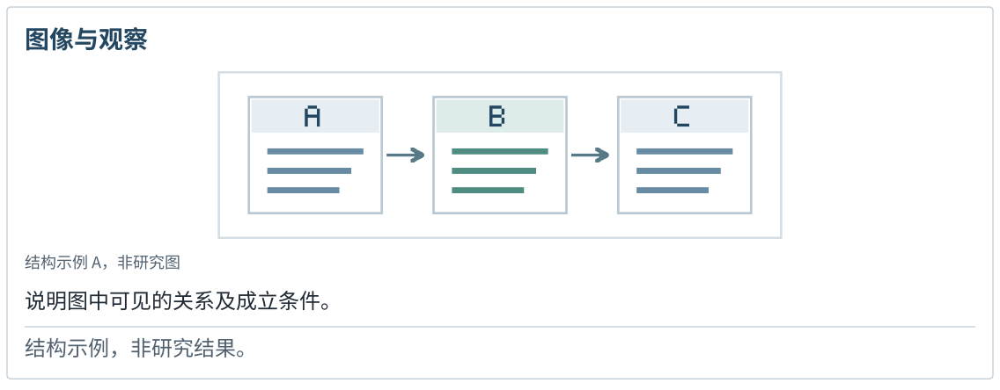
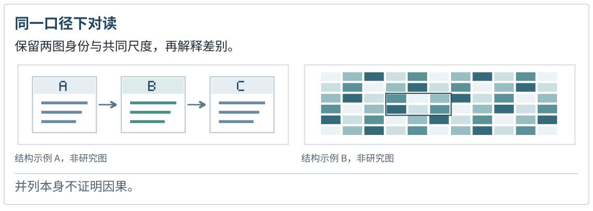
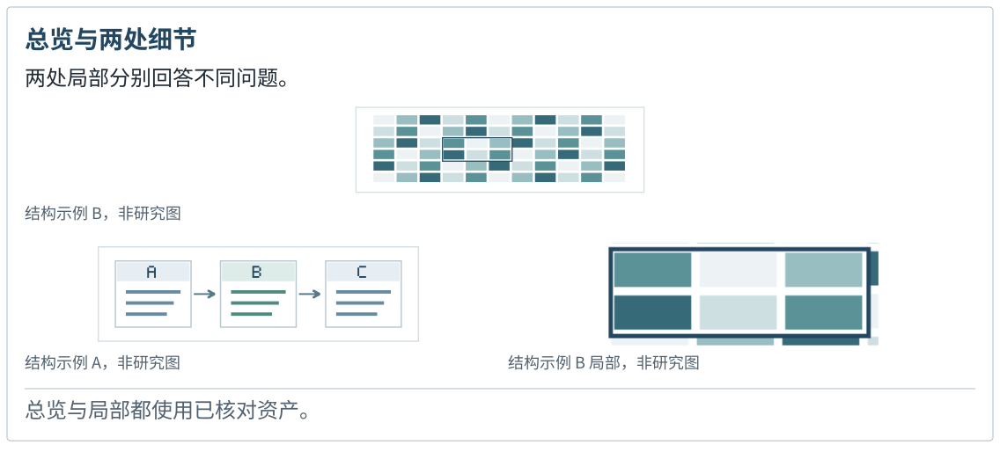
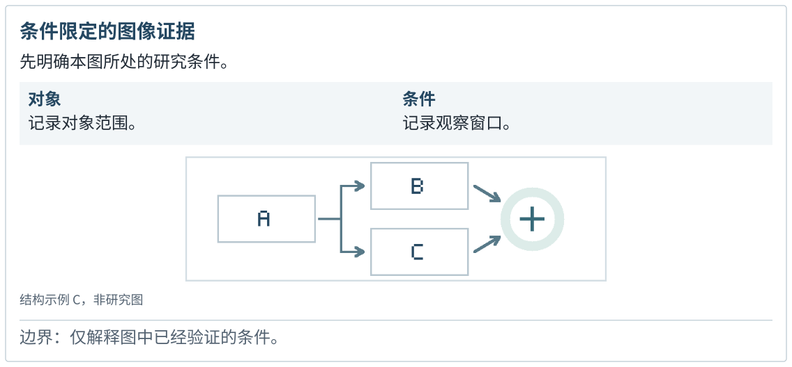
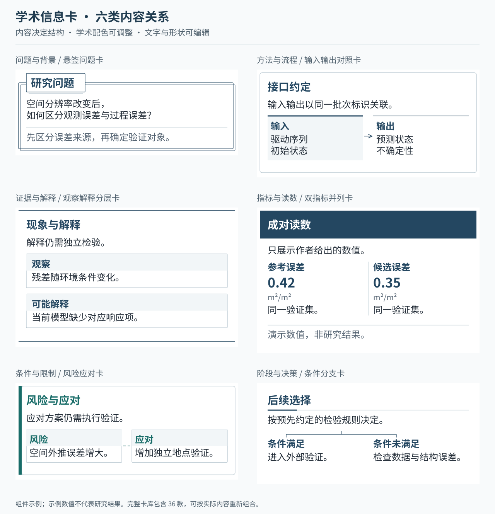
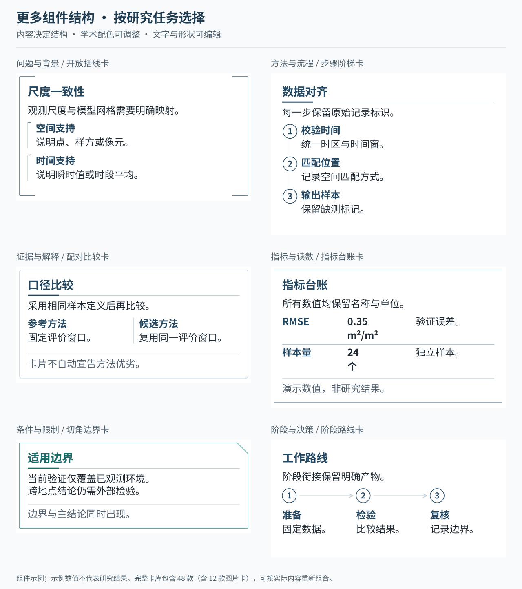

# dsh-academic-ppt

**面向正式学术汇报的 DSH 插件：先与你确定汇报方向，主动查证文献、取得论文图，再把证据与解释设计成可继续编辑的 PowerPoint。**

适用于论文精读、文献综述、研究进展、组会、开题和答辩。围绕具体研究问题组织故事线，让论文图、方法、比较条件和判断共同可见，并保留章节定位、来源与讲稿。

**v0.8.2** · DSH Desktop / Web · 分阶段设计讨论 · 48 款信息卡 · 12 种图片嵌入式卡片 · 可编辑 PPTX

[下载插件](https://github.com/YuZhou0311/dsh-academic-ppt/releases/latest) · [安装与升级](docs/INSTALL.md) · [完整卡片图册](skills/dsh-academic-ppt/references/card-library/index.html) · [发布说明](docs/RELEASE_NOTES.md) · [实际验收](docs/VALIDATION_V082.md)

## 实际汇报效果

下图来自一次完整前向验收：新子智能体没有继承此前对话，以一句话开始，经过 5 轮设计讨论，独立查证三篇论文并制作 12 页学术汇报。封面与正文均为最终 PPTX 的实际渲染。

| 简洁的学术封面 | 真实论文图嵌入双图卡 |
| --- | --- |
|  |  |

样稿的四个论文图页分别采用图与四方案表、同卡双图、误差条形与散点图、完整热图。主体解释主要为 19.5–21 pt；科学内容与视觉结构经独立审查，没有必须返工的问题。这个实例展示一次实际结果，不代表不同模型、主题和资料条件都能自动达到相同质量。[查看交互、取图、原生对象与验证范围](docs/VALIDATION_V082.md)。

双图卡中的论文图来自 Pan 等（2019），*Sensors*，DOI [10.3390/s19143161](https://doi.org/10.3390/s19143161)，按 [CC BY 4.0](https://creativecommons.org/licenses/by/4.0/) 使用；分别摘取 Fig. 5b/5f，保留坐标与曲线，重新排版并补充共同图例。页面文字和容器由本项目设计。完整署名与改动见 [THIRD_PARTY_NOTICES.md](THIRD_PARTY_NOTICES.md#082-前向验收公开页面)。

## 先讨论，再把方向做成页面

Agent 会结合材料给出具体推荐，用少量相关问题逐步确定汇报感觉。用户已经表达的偏好会继续沿用；明确交给 Agent 决定的部分，由它自主完成。

| 讨论主题 | 怎样影响最终页面 |
| --- | --- |
| **信息密度** | 区分现场讲述、答辩兼复读与阅读材料，协调图面大小、文字长度、字级和讲稿分工。 |
| **故事线** | 从当前论文的研究问题、方法分歧、证据或研究进展提出具体路线，决定章节推进与每页任务。 |
| **配色** | 推荐 2–3 套正式学术色板，结合原图中的变量色、观看场景和用户偏好确定颜色职责。 |
| **形态** | 讨论干净利落、温和圆润或克制混合，落实到边角、细线、题签与局部分组。 |
| **语言** | 选择精炼判断句、解释型学术表达或更充分的专业讨论，保留研究条件和证据边界。 |
| **层次质感** | 选择开放平面、浅底分组或轻微层次，服务信息归属与主次。 |
| **封面** | 展示实际封面候选和代表正文，比较题名组织、元信息、图文比例与可读性后确定方向。 |

每轮通常处理 1–3 个相关决定。等待设计反馈时，查证、全文阅读和取图仍可继续；批量定稿以真实选择或明确委托为依据。局部改稿沿用已有方向，不重新问一整套问题。

## 用真实论文图表达研究

先核对论文身份与全文，取得并查看结果图、方法图和必要的研究插图，再安排每页的比较、解释与条件。只给主题或 DOI 时，Agent 应使用宿主提供的检索、下载和 PDF 处理能力主动获取材料。

论文原图保留为独立图片，可以开放展示，也可以嵌入图卡。题签、解释、读数、标注与布局保持可编辑；受支持的数据图、表格和方法关系可用原生对象表达。可编辑交付不要求把原始曲线、误差带或实验图改写成文字。

来源记录会追踪候选图、选中资产与实际入稿页面。缺图、仅登记未上页、图过小和连续文字页会进入检查；确实没有适用原图时，记录具体依据并采用有来源的替代表达。

## 图片嵌入式卡片展示

图卡把真实图片与读图提示、比较条件或局部读数组合为一个证据组。图片按原比例显示，图卡本身不会为了填满边界自动裁切；图题、说明和边界由原生对象组成。

| 完整图与解释 | 成对图像与共同条件 |
| --- | --- |
|  |  |

| 总览与两个局部 | 条件、图像与边界 |
| --- | --- |
|  |  |

以上图像为本项目的原创结构示意，不含研究数据。实际汇报使用已经取得、核对并登记来源的论文图或研究素材。

12 种图卡包括：上图下释、图左释右、释左图右、同尺度并图、上下图列、三阶段图序、2×2 证据窗、总览与局部、总览与双局部、图旁短注、图与成对读数、条件与边界。它们是可组合的局部结构，同一页还可以使用开放大图、跨栏比较、上下证据带、表格和方法流程。

[查看 12 页图卡参考 PPTX](skills/dsh-academic-ppt/references/card-library/figure-cards.pptx) · [浏览全部 48 款卡片](skills/dsh-academic-ppt/references/card-library/index.html)

下载后可在浏览器打开图册 `index.html`，按用途筛选并查看槽位；GitHub 文件页显示其源码。卡片数量与样式数量不是汇报的合格配额。

### 其他学术信息卡

查看更多文字、数值与关系卡片

| 家族 | 适合表达的内容 |
| --- | --- |
| 问题与背景 | 研究问题、语境、概念定义、背景观察、编号议题 |
| 方法与流程 | 输入输出、操作步骤、公式释义、实验协议、算法过程 |
| 证据与解释 | 判断与依据、来源定位、证据追踪、配对比较、观察与解释 |
| 指标与读数 | 单项读数、双指标、基线参照、目标与观测、指标台账 |
| 条件与限制 | 适用边界、工作假设、覆盖范围、风险与应对、条件核对 |
| 阶段与决策 | 阶段路线、里程碑、条件分支、完成与待办、下一步行动 |
| 图片与证据组 | 论文图与解释、同尺度对照、总览与局部、图中读数、条件与边界 |

## 学习参考，按内容继续设计

新稿需要查询卡片目录、查看适合当前信息关系的实际预览，再记录选择与改造。参考学习落实到配色、图文比例、题签、内部区域和页面组合，支持使用预设，也支持用原生对象重新组织。

用户可以提供 PPTX 设计参考。Agent 会确认是否需要模板、分析实际文件并查看代表页，学习其层级、比例和信息组织。普通参考模式保留自主设计；明确要求沿用版式时才采用忠实模板模式。没有模板时沿用内置参考与内容驱动流程。

宿主有可用生图工具时，按已讨论的方向优先生成内容相关的卡片设计参考，实际查看后重建为可编辑对象。生成参考不作为实验图片或精确数据来源；没有生图接口时，继续学习原生图册并完成设计。

## 让每一页有自己的表达任务

同一研究问题可以需要多组证据、方法说明和边界。插件支持自由分栏、分块、跨栏和局部嵌套，按阅读关系分配空间；同一实验的比较保持共同尺度，不同任务可以采用不同图文组合。

构图检查会分析实际导出对象的相对位置，提示连续或大比例出现的同类骨架，例如整稿反复采用“左图右解释”。这些提示帮助作者回看逐页任务，不以随机换版或增加样式数量作为目标。

文字先做内容编辑：减少标题、卡片和页末结论的同义复述，保留单位、基线、样本与结论边界，再根据观看方式选择字号。排版增加科研数值、单位与上下标标识的断行保护，并提示汉字短末行和不合适的标点换行。无法放下的完整单元会要求调整宽度或布局；实际可读性仍由最终 PPTX 渲染复核。

## 开始使用

1. 从[发布页](https://github.com/YuZhou0311/dsh-academic-ppt/releases/latest)取得插件安装包。
2. 按[安装说明](docs/INSTALL.md)安装到正在使用的 DSH Desktop 或 Web 环境，并启用插件。
3. 在新会话中加载 `dsh-academic-ppt` 技能，给出题目、材料或 DOI；听众、时长和模板可一起提供。

可以用一句话开始：

> 请用 dsh-academic-ppt，根据工作区里的论文和数据制作一份 15 分钟的研究进展汇报，并与我逐步确定设计方向。

已有明确偏好时直接补充，例如“现场讲述，字少一些且更大，整体干净利落”。希望自主完成时可以说明“设计细节由你推荐并决定”。模板不是必需材料；旧版 `.ppt` 需先转换为 `.pptx`。

## 从资料到交付

| 阶段 | 主要工作 |
| --- | --- |
| 讨论方向 | 逐步推荐并确定密度、故事线、配色、形态、语言、层次和封面，保留真实反馈。 |
| 查证与取图 | 核对题名、DOI 和版本，取得全文、图注与原图，记录真实获取状态及具体缺口。 |
| 组织论证 | 确定中心问题、章节任务、逐页承接和时间分配，安排目录与分节定位。 |
| 设计页面 | 先安排实际图表，再写必要解释；查看参考、制作困难页候选，按内容改造图卡与开放区域。 |
| 构建与复核 | 检查证据和图源实际使用，生成并查看 PPTX，修复断行、文字负担、缺图、缩图和重复构图。 |
| 继续修改 | 按反馈修改指定对象或整页，保留版本、讲稿、证据与可恢复工程。 |

每次构建生成独立导出目录，包含可编辑 PPTX、HTML/SVG 预览、讲稿、证据清单和检查结果。安装可选渲染引擎后，可生成实际 PPTX 的页面图与 PDF；中文字体按[安装说明](docs/INSTALL.md)配置。

页面设计、提问与可选生图调用由 DSH 当前会话的模型执行。插件提供流程、记录、原生导出与可计算检查，实际来源、科学解释和画面仍须核对。支持的 DSH Host 范围为 `>=0.2.1-rc.2 <0.3.0-0`，具体安装机制与验证边界见[DSH 兼容说明](docs/DSH_COMPATIBILITY.md)。

## 文档与开发

- [安装、升级与环境配置](docs/INSTALL.md)
- [DSH Desktop / Web 兼容说明](docs/DSH_COMPATIBILITY.md)
- [v0.8.2 发布说明](docs/RELEASE_NOTES.md)
- [v0.8.2 完整前向验收与测试范围](docs/VALIDATION_V082.md)
- [完整卡片图册](skills/dsh-academic-ppt/references/card-library/index.html)

源码提供同源 CLI 与 core API。安装依赖后可运行 `npm test`、`npm run check`；源码 CLI 使用 `node bin/academic-ppt.mjs --help` 查询命令，具体参数与开发流程见安装说明。

项目使用 [MIT 许可](LICENSE)。第三方组件及署名见 [THIRD_PARTY_NOTICES.md](THIRD_PARTY_NOTICES.md)。
