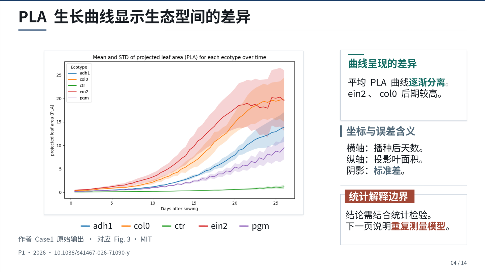
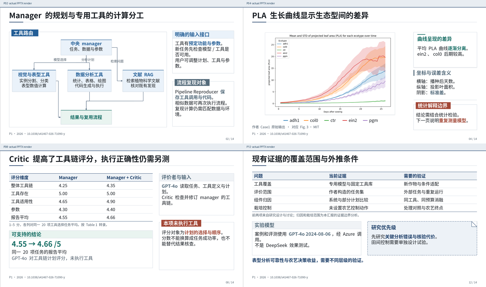

# dsh-academic-ppt

**面向论文精读、学术组会和研究方案汇报的 DeepSeek Harness 插件。**

把研究问题、论文证据、真实原图和模板组件组织成可编辑 PPTX，同时保留讲稿、来源记录和可以继续修改的工程。让模型负责阅读与判断，让工具负责可追溯的数据结构、排版、版本和检查。

当前版本为 **0.3.0 公开预览版**。源码和版本包发布于本仓库；尚未发布 npm。它是独立插件，可与 [dsh-ppt](https://github.com/STARDUSTLC666/dsh-ppt) 共存；学术工程使用自己的 `academic_ppt_*` 工具和 JSON 格式。

[安装与首次使用](docs/INSTALL.md) · [48 页学术模板](skills/dsh-academic-ppt/references/templates/README.md) · [原模板研究](docs/USER_TEMPLATE_STUDY.md) · [图片与视觉方法](docs/VISUAL_DESIGN_V03.md) · [设计说明](docs/DESIGN.md) · [验证范围](docs/VALIDATION.md) · [学术工作流](skills/dsh-academic-ppt/SKILL.md) · [真实论文示例](examples/README.md)



上图来自随附的真实论文示例：[可编辑 PPTX](examples/report.pptx) · [讲稿](examples/speaker-notes.md) · [原图与授权](examples/ASSETS.md)。页面标题、论证、卡片、流程、必要表格和数据图表均为原生对象；论文原图作为独立图片保留。原图可设置非破坏的局部展示窗口，原始媒体仍保存在 PPTX 中。

## v0.3：让图片、层级与版式相互适配

本版重做 14 页真实论文示例和 48 页参考包，针对上一版实际画面暴露的问题调整工具与技能。先判断要从图中读什么，再选择图和布局；不把大幅密集竖图压进狭窄半栏，也不靠空卡片增加装饰。

| 制作问题 | v0.3 的具体做法 |
| --- | --- |
| 图片尺寸匹配，但内容不可读 | `asset.reading` 记录图的职责、必要元素与关键标签测量；参考工具返回最多三个真实槽位候选；不合适时用受控图框或拆页 |
| 标题、变量和结论都一样重 | 主标题 40、区域标题 26、正文 24 场景 px 为起点；`emphasis` 保留原生粗体和彩色关键词，指标与变量/分母共同出现 |
| 小字过多、重要条件藏在顶栏 | 移除示例中装饰性 kicker；正文与必要条件保持可读尺寸，简洁图注与完整来源分工 |
| 卡片换颜色却不表达关系 | `kind` 同时驱动方法、设置、结果、限制、假说的颜色身份；题签、侧标、细框、开放解释与虚线按关系组合 |
| 色块松散，图文缺少整体感 | 图片细框跟随真实图像边界；选择性使用浅阴影；短表后的解释跟随实际表高，不留下脱节大空白 |
| 提示只要求“高级、好看” | 提供读图契约、短设计记录、2–3 个候选、难例先行和实际 PPTX 逐页复核，让模型有可执行的依据 |

这些字号和几何预警是制作起点，不是投影设备的通用保证。图像语义仍需实际查看，颜色不修改作者数据系列，自动检查不代替审美判断。具体过程见 [图片选择](skills/dsh-academic-ppt/references/figure-selection.md)、[视觉决策](skills/dsh-academic-ppt/references/visual-decision.md) 和 [DeepSeek 执行指导](skills/dsh-academic-ppt/references/deepseek.md)。



[查看完整 14 页总览](examples/overview.png)。预览均来自实际 PPTX 渲染；所有讲稿与数字由同一份源记录生成。

## 学术模板参考包

本次重新读取并实际查看两份用户学术模板的 **39 页**，提炼紧凑标题、目标横条、细边框题签、图文交错与局部放大等结构，再制作新的参考包。模板用于帮助模型按内容选版；不要求每页填满所有信息，也不把“主张、证据、边界”固定成三张卡片。

- [48 页可编辑模板全集](skills/dsh-academic-ppt/references/templates/academic-templates-48.pptx)
- [分类说明与使用入口](skills/dsh-academic-ppt/references/templates/README.md) · [本地可浏览画廊](skills/dsh-academic-ppt/references/templates/gallery.html)
- [逐页输入记录](skills/dsh-academic-ppt/references/templates/slide-records.json) · [模板索引](skills/dsh-academic-ppt/references/templates/manifest.json)

| 类别 | 可编辑参考包 | 覆盖任务 |
| --- | --- | --- |
| 论文导读 | [6 页](skills/dsh-academic-ppt/references/templates/paper.pptx) | 完整题名、缺口、贡献与证据范围 |
| 方法与机制 | [6 页](skills/dsh-academic-ppt/references/templates/method.pptx) | 智能体闭环、工具路由、强化学习接口与模型耦合 |
| 实验设计 | [6 页](skills/dsh-academic-ppt/references/templates/experiment.pptx) | 独立样本、因子、对照、数据划分与测量链 |
| 结果与统计 | [6 页](skills/dsh-academic-ppt/references/templates/results.pptx) | 主效应、消融、鲁棒性、权衡与错误分析 |
| 原图解读 | [6 页](skills/dsh-academic-ppt/references/templates/figure.pptx) | 宽图、竖图、双/三面板、局部放大与图例 |
| 跨文献综合 | [6 页](skills/dsh-academic-ppt/references/templates/synthesis.pptx) | 方法对应、证据等级、进展、分歧与研究缺口 |
| 局限与失败 | [6 页](skills/dsh-academic-ppt/references/templates/limitations.pptx) | 失败过程、迁移、偏倚、效度与复现 |
| 研究方案与附录 | [6 页](skills/dsh-academic-ppt/references/templates/plan.pptx) | 可检验假设、公平对照、工作计划、结论与书目 |

参考包中的图表和数据均标为教学示例；真实论文示例另列来源。公开包中的模板是本项目新制作的原生对象，不包含用户完整源模板及其中原有研究材料。

## 能解决什么问题

- **论文有深度、有出处。** 记录完整题名、实际阅读版本、方法、实验设置、原文位置、结果与局限；区分作者报告、汇报者解释和待检验假设。
- **用户条件得到保留。** 按要求检查已关联论文的篇数、全文记录，以及带年度和来源的期刊影响因子。缺项会阻止 review 构建，不会静默降低条件。
- **科学图可追溯。** 引用真实论文图，登记图号、面板、图注、版本、裁切说明和许可；图保持比例，说明与来源作为独立可编辑对象。
- **模板进入具体组件。** 读取 PPTX 的字体、颜色及受支持的原生矩形、椭圆、线条与其组合，保留源组件 ID；按路径导入模板资料，模型不必重写大段几何数据。模板中的旧文字不会被当作新论文内容导入。
- **页面和卡片有结构变化。** 提供 48 个可直接驱动生成的学术页型和 14 种局部块样式，包含淡蓝表头、嵌边题签、侧签与开放解释区。根据研究任务、主图方向和证据关系选择，兼顾紧凑程度与阅读主次。
- **局部修改可以核查。** 用户只要求小卡片时，样式修改保留卡片内容、数值、外框位置和大小，以及目标以外的场景对象与备注；返回修改范围检查。目标卡片内部文字位置可以随所选结构调整。
- **讲稿与版本同步。** 将逐页备注和时间预算导出为 Markdown；修改后重新构建，避免旧讲稿对应新页面。
- **检查范围明确。** 分开记录证据结构检查、几何估计、HTML 预览、真实 PPTX 渲染和视觉审查；审查与具体成品哈希绑定。选定页型没有实际呈现已配置的图、卡片、图表或流程时，review 构建会报告问题。

## 适合哪些任务

适合多篇论文的研究进展报告、单篇深度组会、开题中的方法比较与研究切入点，以及已认可版本的小卡片改进。特别适合“给定论文数量和期刊要求、使用我的模板、尽可能引用论文原图、保持可编辑”的任务。

插件不会自动判定论文事实为真，也不提供任意外部 PPTX 的无损编辑。论文检索、阅读全文和观看图像仍由当前 DSH 会话中可用的模型与宿主工具完成。

## 安装

需要 Node **`^22.19.0 || >=24.0.0`**，以 [package.json](package.json) 为准。下载本仓库源码，或克隆固定发布版本：

```sh
git clone --branch v0.3.0 https://github.com/YuZhou0311/dsh-academic-ppt.git
cd dsh-academic-ppt
npm ci --ignore-scripts
node bin/academic-ppt.mjs --help
```

使用自己电脑上的真实路径安装到已经初始化的 DSH 桌面 profile：

```sh
dsh plugin --profile desktop add "file:/absolute/path/to/dsh-academic-ppt"
```

网页版把 `desktop` 换成 `web`。安装后重启对应 DSH。**不要把上面的本地路径换成尚未发布的裸 npm 包名。** Windows、pnpm、profile 与源码更新说明见[安装文档](docs/INSTALL.md)。

普通 PPTX/HTML 生成不要求 Office。默认安装包含用于实际 PPTX 图片/PDF 渲染的可选官方 `@deepseek-ai/libreoffice-kit`。只需要普通生成时可使用 `npm ci --ignore-scripts --omit=optional`；没有可用引擎时渲染工具返回明确的不可用状态，仍可保留已生成的 PPTX 和 HTML。字体缺失时可为 render 指定工作区内的字体目录，详见安装说明。

发布页还提供 `.tgz` 安装包，可直接在 DSH 插件管理中选择下载后的完整文件路径；源码归档包含锁文件和开发测试。二者的具体步骤见[安装文档](docs/INSTALL.md#1-准备本地包)。

## 在 DSH 中这样使用

### 制作新汇报

把论文、补充材料和 PPT 模板放入本次工作区，然后发送：

> 使用 dsh-academic-ppt 制作一场 12 分钟的学术汇报，围绕 AI 智能体或强化学习用于农业栽培。精读 5 篇满足我指定 IF 10+ 条件的文章，逐篇保留指标年份与来源。先查清研究问题、方法接口、实验、关键结果和局限，再从我的两份模板中提取适合的原生组件。每篇保留完整题名，尽可能用论文原图。给出可证伪的研究切入点和公平对照设计，保持文字、卡片、标注与机制图可编辑。缺失全文或不能验证的条件如实说明。

这只是一个使用示例；篇数、期刊门槛和时长以你的实际任务为准。

### 改进小卡片

> 继续当前学术工程，保留我认可的页面结构、文字、数字、论文图、页序和讲稿。只改我指出的小卡片边框与结构，使用模板里适合的题签和原生组合。请按 slideId/cardId 限定范围，检查卡片外框与目标之外的对象保持不变，再生成新版本。

若要修改研究内容或整页布局，应明确提出相应范围；样式工具会拒绝夹带这类改动。

### 继续中断的任务

> 打开这个项目的 project.json，用 academic_ppt_context 恢复当前版本、证据缺项和后续任务。从已经完成的步骤继续，不重新选文或重设计全稿。

## 十一个工具

| 工具 | 作用 |
| --- | --- |
| `academic_ppt_init` | 创建中心问题、听众、时长与文献条件明确的工程 |
| `academic_ppt_record` | 分批登记论文、证据、资产、页面和模板 profile 路径 |
| `academic_ppt_context` | 读取当前状态、缺项与聚焦记录，恢复长任务 |
| `academic_ppt_template` | 盘点模板，保存受支持原生组件及不支持项 |
| `academic_ppt_reference` | 按研究任务检索 48 个页型，或按图片阅读条件返回至多三个适配候选 |
| `academic_ppt_build` | 构建可编辑 PPTX、HTML、备注与来源产物 |
| `academic_ppt_edit` | 按稳定 ID 进行卡片样式或明确的页面内容修改 |
| `academic_ppt_undo` | 将上一内容状态恢复为新修订 |
| `academic_ppt_render` | 用可选引擎渲染当前实际 PPTX |
| `academic_ppt_check` | 检查证据结构、几何、成品一致性与审查范围 |
| `academic_ppt_review` | 登记真实完成且与当前哈希对应的视觉审查 |

写入类操作使用当前 `expectedRevision`，避免旧状态覆盖新改动。每批最多 5 篇论文、20 条证据、8 个资产、8 页；已构建页面的更改走 `edit`。完整参数见 [schema](src/schema.mjs) 与[命令行说明](docs/INSTALL.md#4-命令行使用)。

## 你会得到哪些文件

工程目录中的 `project.json` 保存研究、设计、资产与可恢复状态。每次构建在新的 `exports/` 子目录中产生：

| 文件 | 内容 |
| --- | --- |
| `report.pptx` | 原生文字、形状、必要图表与独立论文图 |
| `report.html` | 可浏览的页面预览 |
| `speaker-notes.md` | 当前页序的讲稿备注与时间预算 |
| `evidence.json` | 任务条件、论文和证据记录 |
| `asset-manifest.json` | 图片来源、版本、图号、裁切与摘要 |
| `quality.json` | 本次构建的检查结果与范围 |
| `previews/` | 按页保存的 SVG 预览 |

可选实际渲染在另一个目录保存图片/PDF 与渲染记录。文章全文、用户模板和字体不因存在一个 URL 就自动打包；需要实际取得材料并保留其使用说明。

## 能力边界与验证

**全文和证据记录是结构化声明。** `full-text`、已读章节与 `verified` 需要执行者真实核对。代码检查字段、引用链和部分数值口径要求，不会上网替你证明每篇文章或每个结论真实。研究方案的“已核查”表示依据核对过，不能解释为假设已实验成立。

**模板复用有明确子集。** 当前受控组件使用矩形、椭圆、线条及支持的组合，复杂特效、媒体、图表或母版关系可能不支持。查看 `unsupported`；不能将盘点成功称为任意模板无损克隆。

**可编辑不等于拆解论文原图。** 页面解释层、卡片和必要图形保持原生；论文图可独立替换、缩放，但其内部作者绘制元素通常仍是图像。

**模型由 DSH 管理。** 插件不选定或切换模型、不另调私有 LLM API。视觉能力依据宿主当前模型和实际端点确认，不能仅凭模型名称或手填状态判断。它不会把 unknown 当作视觉通过。

**HTML 检查不等于 PPTX 检查。** 最终交付状态要求当前 review 构建、对应 PPTX 渲染记录、覆盖页面的审查记录及字体状态。人或模型登记的审查仍是声明，插件不会因为收到了 `passed` 就声称独立判断了审美。

**新构建不覆盖 Office 手改。** PowerPoint/WPS 的修改不会回写 JSON；插件将新构建保存到新目录，保留旧成品。这不是 Office 与 JSON 的往返同步。

具体已运行的测试与未验证环境见 [VALIDATION.md](docs/VALIDATION.md)。本地测试与样例不能替代真实 DSH 会话、DeepSeek 端到端效果评测和目标机器的显示检查。

## 设计与来源

工作流将学术汇报制作中的返工经验落实为可执行结构：完整题名、真实证据、模板对象与比例、语义不同的小卡片、范围明确的修订，以及分层验收。DeepSeek 适配依据与评价方法见 [DESIGN.md](docs/DESIGN.md)。

本项目参考 `dsh-ppt` 的插件与可选渲染实践；具体保留代码和依赖的署名见 [THIRD_PARTY_NOTICES.md](THIRD_PARTY_NOTICES.md)。插件代码采用 [MIT](LICENSE)。论文、模板、字体与其他第三方素材各遵循自身许可。
