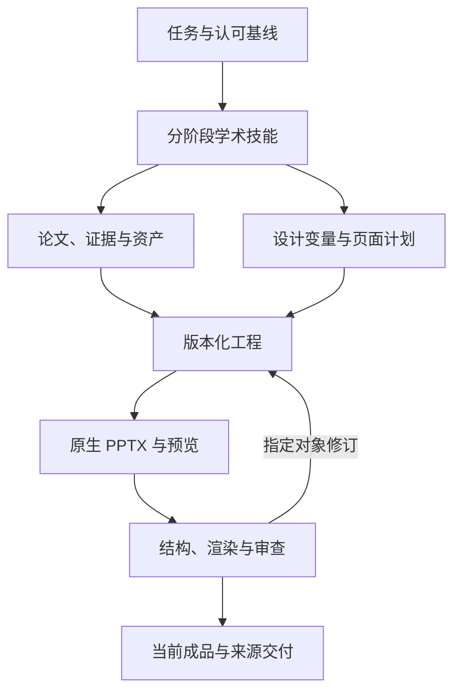

# 学术汇报插件设计

> 历史 v0.6 设计记录。文中的“本轮/当前/默认”指当时版本；rc.4 的自由构图、字号与候选流程以 [RESEARCH_NATIVE_DESIGN.md](RESEARCH_NATIVE_DESIGN.md) 为准。

本轮设计更新：**2026-10-21 UTC，v0.6.0，renderer 7**；下述 DeepSeek/DSH 官方协议保留 2026-10-20 的核对身份。本文区分代码能力、模型或人负责的设计判断，以及仍需进行的效果评测。发布状态见[版本说明](RELEASE_NOTES.md)，接口以 [schema](../src/schema.mjs)、[core](../src/core.mjs) 和[安装说明](INSTALL.md) 为准；本次工作流见 [CONTENT_LED_DESIGN.md](CONTENT_LED_DESIGN.md)，外部机制参考见 [DESIGN_REFERENCES.md](DESIGN_REFERENCES.md)。原始问题定位见 [AUDIT_V04.md](AUDIT_V04.md)，后续历史改进见 [AUDIT_V05.md](AUDIT_V05.md)。

目录：[需求约束](#1-从用户反馈提炼约束) · [DeepSeek 适配](#2-deepseek-特点如何影响工程设计) · [结构](#3-三层结构与职责) · [证据](#4-证据先于页面) · [设计](#5-将审美经验落实到结构) · [局部修改](#6-小卡片修改的保留契约) · [验收状态](#7-四个状态不能合并为通过) · [效果评价](#8-怎样评价是否比通用流程更有效)

## 1. 从用户反馈提炼约束

学术汇报的质量同时取决于证据、论证、视觉、可编辑性与工程一致性。先前返工暴露的具体问题包括：论文完整题名缺失、论文解读浅、原图不足、表格过多、模板只被当作配色、小卡片重复、品牌化留白导致信息不足，以及用户要求局部变化却触发整页重做。历史模板研究对照两份用户源模板的 39 页，将紧凑图文组合和小题签结构落实为参考库，观察记录保留在 [USER_TEMPLATE_STUDY.md](USER_TEMPLATE_STUDY.md)。

本次反馈进一步指出：过度强调应用模板，会把创作变成挑选模板页、替换文字和填满卡片；但仅取消边框、使用开放面板又会产生裸文字组与大片空白。独立报告中的短旁注、结束页和固定页眉暴露了这种偏差。重构需要保留可见分组、信息密度与学术层级，同时让执行者根据研究关系安排页面。先确定问题、证据和解释边界，再判断哪些内容应并列、突出、连接或分开，最后共同设计载体、卡片与空间。

这些要求分别由证据记录、构图决策、设计变量、面板与卡片组件、可选chrome、空间诊断和真实渲染检查支持。学术严谨允许主题图片、语义图标、可见卡片和独立封面；充实程度仍由有效证据与清楚的组织决定，不能通过堆装饰、补造数据或缩小所有文字达成。程序检查引用与可计算几何，模型和审稿者判断论证与视觉表达。

插件的目标是让每项要求都有可以查看的产物和检查入口。它没有把审美或科研判断伪装成完全自动化的布尔测试。

## 2. DeepSeek 特点如何影响工程设计

| 核对日的官方能力或约束 | 工程选择 | 对学术任务的意义 |
| --- | --- | --- |
| 当前模型提供工具调用与思考模式 | 复用 DSH 的模型与工具循环，插件实现确定性业务工具 | 将阅读、归纳与可核查操作分开 |
| `/models` 提供上下文、输出上限、输入模态和推理档位 | 不按模型名硬编码能力；使用宿主当前模型及端点信息 | 防止将文字模型当视觉模型，或按过时上限分配任务 |
| thinking 的历史回传有协议要求 | 由宿主适配器管理 `reasoning_content`，插件不另建聊天循环 | 避免长工具任务因裁剪历史产生协议错误 |
| JSON 形式不等于业务正确，可能出现空内容或截断 | 小批量有类型参数、入口 schema 和语义检查、受控修复 | 将缺引用、缺口径和半截结果挡在落盘/构建边界 |
| 输入模态因模型、端点与宿主配置而异 | `supported/unsupported/unknown` 状态保留来源，视觉审查独立登记 | 只在真实能力可用且实际看图后记录结果 |
| 图像可能被缩放 | 全图定位与必要裁切结合，精确数字对照原文或 source data | 防止小轴字误读成为 PPT 结论 |
| 长上下文与缓存可用，但缓存命中不保证 | 短核心技能、按阶段参考、稳定 ID 和紧凑 context | 便于恢复和定位问题，避免每轮重发全文和巨型工程 |

官方参考：[模型发现](https://api-docs.deepseek.com/api/list-models/)、[Thinking Mode](https://api-docs.deepseek.com/guides/thinking_mode/)、[JSON Output](https://api-docs.deepseek.com/guides/json_mode/)、[Vision](https://api-docs.deepseek.com/guides/vision/)、[缓存](https://api-docs.deepseek.com/guides/kv_cache/)。

模型名称、价格和服务能力会变化，不写入插件选择逻辑。使用时查询实际端点，不采用“某提供商一律不能看图”这类品牌级假设。[当前模型说明](https://api-docs.deepseek.com/quick_start/pricing/) · [更新记录](https://api-docs.deepseek.com/updates/)

宿主的内置目录、自定义 provider 和已登录账户使用不同配置来源。插件不读取凭据、不擅改模型选择；自定义端点声明仍需与真实能力对应。[DSH 模型配置](https://deepseek-harness.github.io/deepseek-harness/en/guide/providers)

## 3. 三层结构与职责

**技能层**是一个短入口、按阶段读取的参考与可选的 48 页布局资源，分别处理研究、证据、构图、修订、DeepSeek 协作和交付。当前模型负责判断信息关系、设计候选与取舍，不必先挑选模板；技能规定真实阅读与科学边界，但不声称代码可以检查所有推理。

**工具层**提供十二个注册工具及同构 CLI。参数采用 DSH 支持的声明格式，执行入口再进行完整校验。详细内容 schema 经 contract 按主题读取，record 经工作区 JSON 文件提交；不删减执行端校验。普通渲染不联网，图片需先由宿主取得并登记，所有文件操作以当前工作区为边界。

**工程层**持久化 brief、papers、claims、assets、slides、设计与历史。稳定 ID 让页面引用证据，让局部补丁明确对象；版本与成品哈希区分“当前内容”“当前导出”“对当前导出的审查”。

## 4. 证据先于页面

### 筛选不能悄悄放宽

`brief` 保留篇数、全文要求和可选 IF 门槛。review 构建检查页面关联的来源、参考文献页、全文记录与指标来源；完整题名导读页只在 requirePaperIntro 明确开启时要求。未指定篇数不增加默认篇数。已登记的要求不能通过替换 brief 降低或删除；用户明确改变要求时新建工程保留旧状态。若不能满足，可以继续做明确的 draft，但不能将草稿包装成已满足全部条件。

IF 保存数值、指标年、来源和核查日期。代码判断登记值与门槛，并检查记录存在；来源是否权威、值是否真实、论文是否适合主题，需要执行者查询原始资料。期刊指标也不能代替单篇方法质量判断。

### 精读需要记录实际证据

按来源实际方法提取研究骨架、机制、验证设计和局限，不以固定阅读轮数冒充精读。每篇保留完整书目、实际版本、真正读过的章节与 analysis；每条 claim 保存类型、原文位置、上下文、指标、推导理由与边界。inference/proposal 经 dependsOn 关联依据，代码拒绝不存在或循环的前提；inference 还需替代解释。正文页 argument 记录本页问题、贡献与边界。

这些字段约束的是可审阅程度。最小长度只排除明显空泛占位，不是深度评分；代码不知道一段长解释是否科学正确。非实验来源可以记录理论条件、定性分析或项目证据，不伪造实验、DOI 和期刊指标。

`reported`、`inference`、`proposal` 区分作者结果、汇报者解释与新假设。`full-text` 和 `verified` 是执行者登记的阅读/核查状态，不是检测器证明。插件专门在检查输出中保留“记录已检查，未独立证真”的含义。

数值口径优先记录分母、单位、基线、聚合方式和实验身份。两个指标分别达标不能推为同时达标；模型轨迹不能称为田间试验；重复拍照不能扩大独立生物样本；奖励不自动等于产量或真实收益。这些语义依赖原文与专门审阅，正则或字段检查只能覆盖其中一部分。

### 研究方向应当能被检验

方案连接已有证据、明确缺口、假设、对照、评价与留出设置。核心对照获得相同观测、预测与计算/工具预算；额外信息有利不能独自证明架构更好。写出何种结果会使假设不获支持，避免用“提升鲁棒性”等技术名词代替研究设计。

## 5. 将审美经验落实到结构

### 明确模板在当前任务中的作用

`design.mode` 使工作指引和设计提醒与用户任务一致：

| 模式 | 适用情形 | 页面设计方式 |
| --- | --- | --- |
| `content-led` | 新工程默认，没有必须遵循的版式 | 依据当前证据组织结构，使用统一的字体、配色与间距 |
| `reference-guided` | 用户提供视觉参考，希望保持相近气质 | 查看真实代表页，选取适用的设计语言，重新组织当前内容 |
| `template-faithful` | 用户明确要求沿用原稿版式 | 在受支持能力内保留指定结构，内容与引用仍需独立核对 |

模式不执行自动布局优化，也不保证任意模板无损复刻。模板中的页序、卡片数量、图文比例、机构与旧研究结论，不因输入模板而自动成为新稿要求。

模板检查返回可写入 `record.design` 的 `suggestedDesign`，包含完整 palette、fontFamily 与受控的 system。system 的 cover、header、panel 和字号真正进入渲染器。推断基于实际几何、继承样式和重复结构，并说明每项决定的来源页、是否发生适配及视觉尚未确认。它不按文件名、研究词语或已知哈希选择特例。

有参考时，`academic_ppt_template({filePath,render:true})` 可以同时生成源 PPTX 的实际页面和编号概览。`suggestedDesign` 默认给出 `reference-guided` 候选，执行者查看并适配后登记；没有参考时无需调用这个工具。只登记 templateProfilePaths 不会改变全局设计；组件导入用于确有需要的局部复用，源文字与图像不进入新研究事实。

### 保存可审阅的构图选择

正文先以 `argument` 明确本页问题、贡献和边界。带 `composition` 的页面可用 `slide.visualPlan` 保存短决策记录：

| 字段 | 含义与约束 |
| --- | --- |
| `relationship` | 比较、序列、机制、层级、证据与解释、矩阵、综合或定义，对应接口中的枚举 |
| `primaryPanelId` | 本页实际存在的主证据面板；声明重点不会自动改变其面积 |
| `readingOrder` | 将本页所有面板 ID 恰好列出一次，不遗漏、不重复、不引用其他页 |
| `rationale` | 简短说明构图怎样支持本页任务，不以空泛的“高级、丰富”代替理由 |
| `alternatives` | 可选，最多两个其他方案，各记录 `structure` 与 `tradeoff` |
| `repetitionReason` | 可选，说明为何有意复用结构，例如保持相同实验条件的可比性 |

关键页可比较两种构图后确定方案，普通页面不强制增加候选。`visualPlan` 是计划与复核记录，不会移动对象；执行者仍需把选择落实到 `composition.rows`、权重和实际内容引用。先确定信息关系，随后为该关系分配空间，避免把“每页不同”作为独立目标。

### 页面与科学关系

新工程默认采用 compact 密度、plain 页眉、关闭顶部横线，以及有轮廓和适度内边距的原生卡片。它们提供可修改的起点；共同字号、色义和间距不应被理解为每页相同标题线与角标。既有 academic-defense / academic-report 预设仍可选择，已有工程缺少新字段时保留兼容分支，不静默替换已认可设计。

封面按题名与主题视觉共同决定构图。cover.variant 支持既有 formal/minimal/framed/project、新增 split/editorial 及自主custom。custom用cover.boxes为title及实际存在的subtitle/occasion/metadata/visual配置{x,y,w,h}，cover.align可left/center/right；位置和比例由执行者决定，不添加预设封面家具。每项实际内容必须有区域，空区、越界、碰撞和文字溢出均报告；metadata按报告人、单位、日期完整测量。

完整题名由 cover.titleLines 指定语义换行，不能删改原题，未知身份省略并移除空基座。cover.assetId、visualCaption 与 icon 提供主题视觉入口，图片与图标二择一，也可都不使用。原生 layout:closing 可使用 closing.variant:statement/evidence、主判断、讨论问题、语义图标和证据卡；复杂综合可用composition，二者不同时设置。封面与结束有不同信息任务，不要求每次都复用一个家族。

封面/结束主题图片用预先登记的 usage:decorative 资产，不列入 slide.figureIds，不作为科学证据；研究原图仍保留其来源、坐标与普通 figure 身份。图像和图标的可用性参与构图，不能在固定稿完成后随意塞图填空。

design.chrome 与 slide.chrome 分别提供全稿起点和逐页覆盖。header 可为 band/rule/plain，showBrand/showSection/showPageNumber/showFooter/showSources/showTopRule 分别控制相应元素，brandLabel 可改写或以空串清除。隐藏无用chrome可回收正文空间；隐藏可见页脚引用不删除证据关联，仍需在图注等适当位置保留来源线索。

`layout:academic` 使用 `composition.rows[].panels[]` 描述从上到下、从左到右的研究关系。面板可分配不等权宽度与行高，承载图、原生统计图、表格、机制图与紧邻解释；字号和证据最小需求共同约束布局。每个已登记载体必须恰好使用一次，不可用空标题面板占位。共同条件与结论带由明确字段呈现，不强制每页都出现。使用边界见 [composition.md](../skills/dsh-academic-ppt/references/composition.md)。

面板是语义分组，可以形成开放图区、短旁注或证据卡。局部 `surface` 可在同一套全局设计中变化：

| `panel.surface` | 呈现方式 |
| --- | --- |
| `inherit` 或省略 | 继承 `design.system.panel` 的全稿默认样式 |
| `plain` | 保留标题、内容与内边距，去除装饰框线 |
| `rule` | 用顶部、标题区与底部线条分组 |
| `tint` | 浅色标题区与边框 |
| `band` | 强调色标题带与分组边框 |

`align:stretch` 默认使用分配到的行高，适合主证据与需要对齐的比较区域。`align:start` 按完整内容测得的最小高度顶对齐，只在不会造成大空洞时用于短组。收紧后仍需处理剩余空间；它不能与同一面板内卡片的显式 `card.box` 或所消费机制节点的 `node.box` 共用，避免自动高度与固定坐标冲突。不兼容的组合会报告错误，省略字段保留原有面板行为。

### 原生卡片与可见层次

面板表面处理区域关系，design.cardDefaults 和 card.appearance 处理独立小卡片。appearance 支持 surface:outline/tint/solid/plain、radius:0–18、padding:12–24、accent:left/top/none 和 elevation:boolean。新工程默认 outline、radius12、padding16、accent:left、elevation:false；逐卡可覆盖。文本容量测量包含真实内边距和图标占位，不仅在旧文字背后补一个框。

card.icon 支持 question/method/evidence/comparison/boundary/hypothesis/satellite/leaf/water/model，由可编辑原生线条和形状组成。图标用于识别概念，不能充当研究证据。独立条件、读图解释与限制通常需要可见容器；外层plain可以搭配内层outline或tint，外层已有明显容器时内层可plain，保留一层主要边界即可。

卡片无需等大，也不按每页固定数量生成。小卡片视觉、字号、证据与正文占幅应共同检查；短句拉成大空框、三组裸文字散落侧栏和层层套框都是需要实际修复的问题。完整字段见[组件语法](../skills/dsh-academic-ppt/references/component-grammar.md)。

机制图的 rows 只安排阶段，edges 明确关系。flow 是有向步骤，feedback 是虚线反馈，association 是无向关联；排版不能凭节点顺序创造因果。独立映射不共用一条会暗示汇合的总线；无法保持关系与可读性的结构报告具体问题。

原生 distribution 图绘出每个显式观测，防重叠的垂直错位不表示新变量；独立样本不连成折线。interval 图使用明确 estimate、lower、upper，默认零参考线。绘图器不计算置信区间，区间计算及其定义需绑定来源。更复杂的统计图可以用有计算来源的作者自制图像，不能把不支持的统计含义强行塞入现有接口。

14 种底层布局包含新的 academic 与 section，以及 12 种既有类别。48 页中性参考库保留作为补充；它们是具体槽位，不是模板旧正文。组合页按内容形成结构，免于必须先选一个参考编号。含题签的既有参考页仍需要当前研究的 panelTitles。

默认正文为 24 px（18 pt），解释标题 28 px，来源图注 18 px，按 1280×720 画布换算。字号范围由公共契约约束；拥挤时调整信息组织、比例或拆页，不能自动缩字或删掉研究限定。字符度量和几何检查仍不能替代真实字体与PPTX渲染。

### 将确定性错误与设计提醒分开

[design-quality.mjs](../src/design-quality.mjs) 检查计划与结构是否对应。没有实际 composition 却提供计划、主面板不存在、阅读顺序漏项或重复，属于确定性错误。

缺少设计计划、连续及全稿范围的近似骨架、多个等权纯文字面板、开放区缺少可见卡片边界，属于需要执行者复核的提醒。全稿规则包含非相邻页面，微调权重、换色或加空卡不能算新结构。实际平行比较可说明具体任务与共同尺度；`template-faithful` 不要求打散用户指定结构。理由长度只是可审阅门槛，输出不提供审美分或原创率，也不把填写理由视为已经通过。

[design-geometry.mjs](../src/design-geometry.mjs) 独立分析导出场景中的有效内容分布。文本按估计行范围计入，原图、图表和表格视为完整科学载体；背景、卡框、图标与正文装饰不能抹去空洞。原图内部留白不受惩罚。封面上下文图片可单独计入视觉分配，保持非证据身份。

新工程 density:compact 下，正文/closing 连续空区达到正文区 25%、cover 达到50%时报告 large-unused-region 并阻断；提前提醒分别为20%和28%。section 为34%提醒、60%阻断；references 达到28%只提醒合并或重排。balanced及旧缺省模式保留提醒。算法采用8px采样网格与光学余量，是工程策略而非通用美学标准；不代替实际渲染检查。repetitionReason不豁免密度问题，也不能把compact改成balanced来消除失败。

修复针对主证据面积、行列和卡片排列、解释邻近关系、页数与缺失分析。不得用底色、空框、重复文本、虚构观点或损坏原图填满画面。

### 可编辑性具体到对象

PPTX 使用原生文字、形状、连接线、必要表格和支持的原生图表；论文图保持独立图像。原生表格保存相同长度的列与行，每个来源 claim 参与全文、可见来源与完整题名门槛。图的 `viewport` 为 0–1 归一化原生裁切窗口，原始媒体 bytes 不变，SVG 与 PPTX 使用相同裁切几何。HTML/SVG 与 PPTX 共用场景决定布局，但不同渲染器仍可能有字体与换行差异。选定页型未消费的图、卡片、图表或流程被作为构建问题报告，避免记录存在却未呈现。精确科学图不使用生成图冒充，也不要求把作者图片虚构成可编辑数据。

## 6. 小卡片修改的保留契约

`card-style` 仅允许 `style`、`accent`、`templateComponentId`、`appearance` 和 `icon`。锁定卡片内容、数值与外框几何，目标之外的场景对象及全部备注进行语义比较；发现越界则拒绝保存。新外观支持真实边界、内边距和图标，不扩大为整页重做权限。

目标卡片内部文字坐标属于该结构的布局，可以随样式调整。保留外框不代表内部每个文字节点逐像素不动；语义场景比较也不等于渲染像素完全相同。这一边界防止把合理结构变化误称为丢失保留性。

需要更改科学内容或整页时采用明确的 `slide-content`，重新复核对应证据。Office 手改不回写 JSON，构建写新目录保留原成品；不宣传任意外部 PPTX 的无损往返。

## 7. 四个状态不能合并为“通过”

1. **记录与几何可构建**：字段、关联和已实现规则没有阻塞问题；几何仍包含估计。
2. **预览已查看**：实际检查当前 HTML/SVG 页面，但尚不能代替最终 PPTX。
3. **PPTX 已渲染**：可选 Kit 对当前文件生成图片/PDF 与回执；生成图像尚不代表判断质量。
4. **对应页面已审查**：人或视觉模型实际查看并登记当前哈希、basis、页面范围和结论。

`readyForDelivery` 组合 academic 质量记录、当前 review 构建、产物一致性、真实 PPTX 渲染记录、页面审查覆盖和字体状态。每页需 observations；有未解决 issue 不能登记 passed。它是过程条件汇总，不是独立的科研真实性或审美分数。HTML 审查不能升级为 PPTX 审查；unknown 视觉能力不能提交为模型视觉通过。

每次内容变更使旧成品与审查失效，需要重建。本轮渲染器版本为 7，已有导出文件保留，旧渲染器的成品需重新构建、渲染和审查。旧哈希、错误页面 ID、失配渲染回执应被拒绝；具体验证范围见 [VALIDATION_V06.md](VALIDATION_V06.md)。v0.5 和 renderer 6 的封存成稿与独立接受记录维持历史身份，不转用为本轮卡片、空间规则或新构图流程的验收。

## 8. 怎样评价是否比通用流程更有效

下面是评价方法，不是本项目已经取得的性能数字。测试时冻结同一论文、可用参考、任务与时间预算，保存模型版本、提示、工具日志和所有产物。分别评价无模板创作、参考视觉语言和明确要求沿用版式的任务。盲评只看最终稿，不向评价者提示所用流程，同时保留失败案例。

| 维度 | 建议指标 | 评价方式 |
| --- | --- | --- |
| 选文条件 | 满足约定主题、版本、篇数和期刊条件的比例 | 独立检查来源，不能只读声明 |
| 科学口径 | 关键数字/分母/单位/基线/场景错误数 | 逐项对照原文与补充资料 |
| 引用覆盖 | 核心论点可追至具体证据的位置比例 | 抽样复核与引用链检查结合 |
| 原图质量 | 来源完整性、裁切保真、图例可读性 | 代码查记录，视觉查图 |
| 论证与切入点 | 主线清晰度、方案可执行性与可证伪性 | 领域评审，说明评分依据 |
| 内容与构图 | 主证据突出程度、关系表达与阅读顺序是否匹配任务 | 对照当前材料、设计记录与最终页 |
| 设计一致性 | 字体、颜色、间距与语义角色是否统一 | 全稿检查；要求忠实复刻时另与指定模板对照 |
| 密度与卡片 | 卡片边界与内边距是否可见、最大连续空区、截字/遮挡与过度重复 | 场景诊断、全尺寸与整稿缩略图审查，装饰不计有效内容 |
| 修改保留 | 非目标场景差异、内容/数值/外框变化 | 补丁检查与渲染复核 |
| 可编辑性 | 原生文字/形状/图表实际可修改 | 包结构和目标软件检查 |
| 讲述与效率 | 实际时长、返工次数、工具成本与失败恢复 | 排练及真实会话记录 |

自动化 fixture 适合验证引用缺项、版本冲突、非法参数、哈希变化、资产缺失和编辑范围。真实 DSH 加载、模型连续执行、视觉判断与目标软件显示需要独立验收。不能从本地工具测试推出“DeepSeek 已能稳定生成优秀学术 PPT”。

## 9. 阅读入口

- 用户安装与 CLI：[INSTALL.md](INSTALL.md)。
- AI 执行入口：[SKILL.md](../skills/dsh-academic-ppt/SKILL.md)。
- 本次自主设计流程：[CONTENT_LED_DESIGN.md](CONTENT_LED_DESIGN.md)。
- 外部设计机制与许可说明：[DESIGN_REFERENCES.md](DESIGN_REFERENCES.md)。
- 当前测试范围：[VALIDATION_V06.md](VALIDATION_V06.md)。
- 第三方署名与代码许可：[THIRD_PARTY_NOTICES.md](../THIRD_PARTY_NOTICES.md)、[LICENSE](../LICENSE)。
- DSH 插件官方协议：[Your first plugin](https://deepseek-harness.github.io/deepseek-harness/en/develop/basic/)。

## 10. v0.3：先读图，再创造适合内容的版式

历史 v0.3 将图片阅读职责、关键标签尺寸与必要科学元素写入资产记录，依据真实槽位提供最多三个候选；固定模板不适合时使用受控图框。字体、语义色、卡片结构与原生辅助图例共同表达信息层级，短表解释按实际高度就近排列。方法、实例与明确边界见 [VISUAL_DESIGN_V03.md](VISUAL_DESIGN_V03.md)；这套规则不将几何分数冒充审美或科学判断。该记录保留当时的版本与验证范围。
