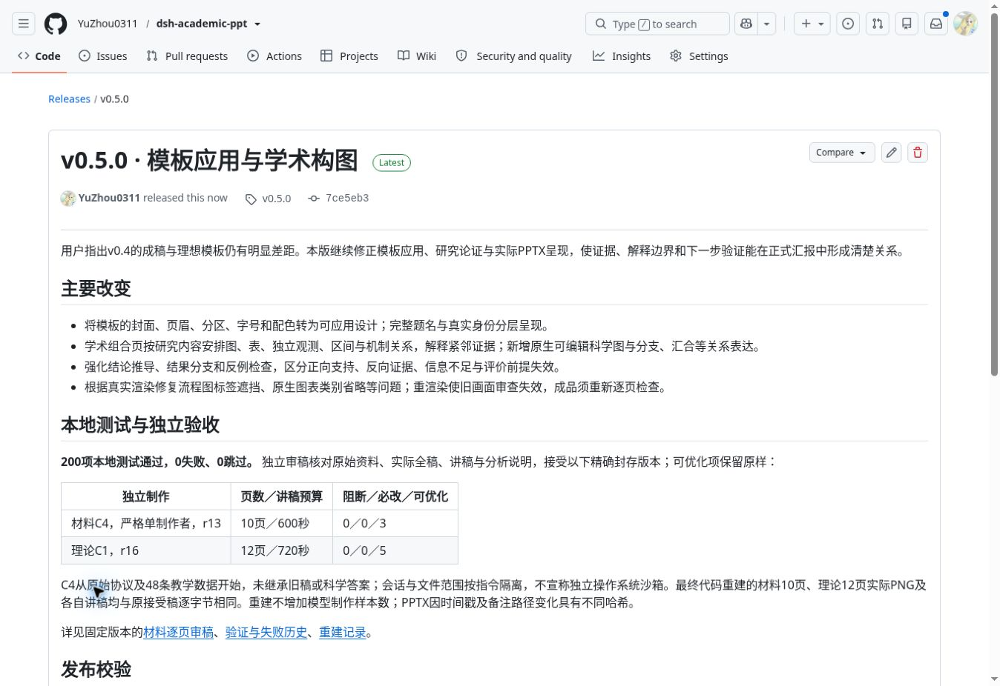

# v0.5.0 发布记录

**v0.5.0 已公开发布。** [发布页](https://github.com/YuZhou0311/dsh-academic-ppt/releases/tag/v0.5.0)显示为 Latest；GitHub API 记录发布时间为 `2026-10-20T13:21:32Z`，`draft=false`、`prerelease=false`。

## 固定版本与验证

标签 `v0.5.0` 指向 [`7ce5eb35f2d522d6938e8d243d4303ee4de9d860`](https://github.com/YuZhou0311/dsh-academic-ppt/commit/7ce5eb35f2d522d6938e8d243d4303ee4de9d860)。发布附件由这一提交的源码树打包，后续文档归档不移动该标签。

[GitHub Actions](https://github.com/YuZhou0311/dsh-academic-ppt/actions/runs/39428919780) 在 Node 22.19.0 和 24.x 均成功，执行提交与标签一致。CI 省略可选渲染器；200项本地测试、实际渲染与逐页审查的范围见 [验证记录](VALIDATION.md)。

安装包完整225个文件与已提交源码逐字节一致；材料源码ZIP的32个文件与公开样例逐字节一致。发布后另核对GitHub返回的六个附件名称、大小、上传完成状态和SHA-256摘要，全部一致。该检查验证发布身份，不增加独立模型制作样本数。

## 下载与校验

| 附件 | 字节数 | SHA-256 |
| --- | ---: | --- |
| [dsh-academic-ppt-0.5.0.tgz](https://github.com/YuZhou0311/dsh-academic-ppt/releases/download/v0.5.0/dsh-academic-ppt-0.5.0.tgz) | 22998601 | `ed6bf7164630ea032cbb8dae3695baccb4614ba11cf1078eb65862e473097e75` |
| [materials-progress-v0.5.0.pptx](https://github.com/YuZhou0311/dsh-academic-ppt/releases/download/v0.5.0/materials-progress-v0.5.0.pptx) | 595436 | `2e83d70d3fc676d36c000312c6187f44b5392b5a514367c36ba1f6efcb2fe990` |
| [materials-progress-v0.5.0.pdf](https://github.com/YuZhou0311/dsh-academic-ppt/releases/download/v0.5.0/materials-progress-v0.5.0.pdf) | 458469 | `f9d4ba280b23cc6ae4741ee4c38fe7e2574e3eb989a0e1613bda6b646344ae96` |
| [materials-progress-v0.5.0-speaker-notes.md](https://github.com/YuZhou0311/dsh-academic-ppt/releases/download/v0.5.0/materials-progress-v0.5.0-speaker-notes.md) | 7819 | `e8d2d09f1226ca6cb5f35ac6237fe71ab40b6c201318e786c8ae4a9253e635c2` |
| [materials-progress-v0.5.0-source.zip](https://github.com/YuZhou0311/dsh-academic-ppt/releases/download/v0.5.0/materials-progress-v0.5.0-source.zip) | 2787623 | `1c8c8a6c96005db9fea2529e90c9fb0d10217aa31827c75003d1366114f318ad` |
| [SHA256SUMS](https://github.com/YuZhou0311/dsh-academic-ppt/releases/download/v0.5.0/SHA256SUMS) | 498 | `ead60ab1b700cd50d510aa8c9a6e68d70dfbe928607b810c25d05515c086762d` |

[安装与升级说明](INSTALL.md) · [完整材料样例](../examples/materials-v05/README.md) · [独立制作与失败历史](INDEPENDENT_REVIEW_V05.md) · [最终代码重建](REBUILD_V05.md)

公开材料PPTX、PDF、讲稿为原已接受版本；公开源码记录仅做已披露的可移植路径处理。没有按审稿建议手工改写接受稿。发布元数据按自动审批要求精简，完整原始审计仍保留；省略范围见 [公开验证说明](VALIDATION.md)。

## 发布页面凭证

以下为发布完成后的实际页面截图，原始截图字节保留：

