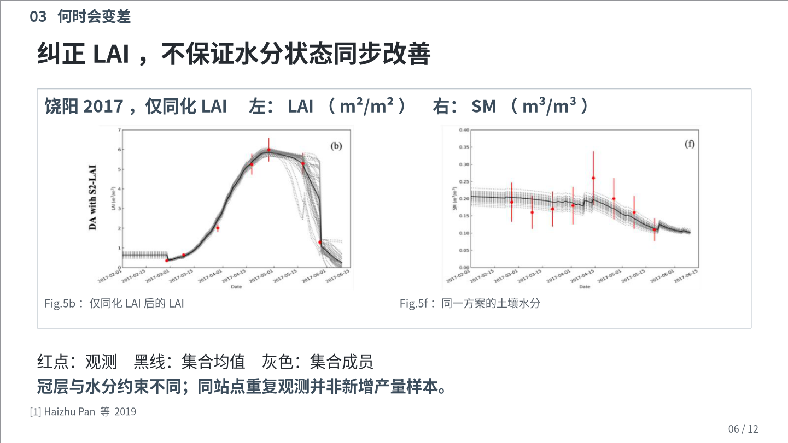

# 0.8.2 验证记录

验证日期：2026-10-26。本记录区分软件回归、DSH Host 兼容、一次完整创作及独立审查；它们不能互相替代，也不构成所有模型、主题和放映环境的质量保证。

## 软件与宿主验证

| 检查 | 实际结果与范围 |
| --- | --- |
| 本地回归 | **440 项通过，0 失败、0 跳过**。覆盖契约、设计交互、图片卡、科研断行、导出和审查状态等。 |
| DSH Host | 插件 0.8.2 在发布的 **0.2.1-rc.2、0.2.1-rc.3** Cordis 服务及工具执行链均通过；环境为 Linux、Node 24.22.1。 |
| Host 操作 | 各执行 10 次工具调用，检查 16 个工具注册、技能发现、48 卡查询、准备契约、创建/重开工程、原生 PPTX 导出、错误参数与越界拒绝、取消及卸载重挂。 |
| 成稿渲染 | 12 页 PPTX 经 LibreOffice Kit 0.1.5 WASM 生成 PDF、逐页 PNG，缺失字体列表为空。 |

Host 验证没有调用 DeepSeek 模型或使用模型凭据，**不是 DSH 桌面端/网页端 GUI 实测**。本次也未在 PowerPoint/WPS 实机放映；后文的作者是任务环境中的 AI 子智能体，不能将其创作结果称为 DeepSeek 模型实测。

## 一句话启动，五轮实际讨论

真实初始提示词如下，仅将会话绝对路径替换为占位符：

> 请使用 `<技能路径>/SKILL.md` 为智慧农业研究生制作一份12分钟的《遥感数据同化如何改进作物估产》学术汇报PPT，需要确认的选择通过父智能体向我提问，并将完整成果放在 `<输出目录>`。

作者以 `fork_turns: none` 启动，没有继承此前对话。但子代理与父代理**共享文件系统，并非安全隔离或严格双盲实验**。根代理扮演需求方回答选择，不是真人受试者；另提供过线程容量与已有字体位置两项运行信息。

| 轮次 | 作者提出的选择 | 实际回答 |
| --- | --- | --- |
| 1 | 现场清晰型/答辩复读型；是否上传参考 PPT | 现场清晰型；没有模板，继续学术设计流程。 |
| 2 | 问题驱动/逐篇论文串讲 | 问题驱动，同时解释收益、变差及可信验证。 |
| 3 | 实际色块、边界预览 | 石墨与灰蓝；主体利落、图卡轻微圆角；保留源图变量色。 |
| 4 | 语言与层次 | 精炼判断句；开放平面为主、局部细线浅底。 |
| 5 | 两个封面与两个证据页的真实渲染 | 选择封面 A、证据 B，确认实际字级和密度后继续整稿。 |

作者自行查找并核读三篇论文，选择源图、制作候选、修改和导出；还自主委派 `report_science_check` 只读检查内容。其后，由作者之外的视觉与来源审查分别核对最终文件，未向作者提供该轮审查提示。这是内部 AI 复核，不是外部同行评审或实验数据复现。

## 成稿实际证明了什么

最终报告为 12 页，讲稿预算合计 720 秒，**没有真人计时排练**。两项最终独立审查均为 blocking 0、must-fix 0；仍保留可选改进，如长标题分层、小日期文字质量、关系线对比、精确图表定位与书目元数据整理。

实际逐页查看了全部 12 页，并核对 PDF、OOXML、讲稿和源图身份。实证页采用“原图＋四方案表”“同卡双状态图”“误差条形＋原始散点图”“完整县级热图”；正文核心解释主要为 19.5–21 pt。关键数值、R²、单位和图面坐标未发现破坏含义的断行或裁切。不能仅凭零错误或粗粒度布局分类认定美观。

卡片库有 **48 种配方，其中 12 种为图片嵌入式卡片**，另有 12 页图卡参考 PPTX。这一份成稿实际使用的是 **一张原生 `figure-pair` 双图卡**，内部有两幅独立论文图；全稿共 5 幅论文图片，分布在 4 页。不能将图库规模写成单份成稿使用量。

参考学习记录包含六种候选、预览与适配理由。公式定义、条件对应等关系被原生重组，未全部套用 preset；完整热图和四方案表也没有为了增加卡片数量被压缩。生成图片只用作设计参考，没有作为研究证据。

来源复核确认 Pan 四方案数值及约 35% 的 RMSE 降幅，区分 Huang 的 KF 融合与 EnKF 同化，并保留 R² 报告口径限制；Zhuo 的 10/11 县比较没有被解释为单独由分辨率造成，也没有把嵌套样方当作独立站点。来源内部差异和适用边界留在讲稿及记录中。

自动检查为 **0 错误、9 警告**：5 项源图标签像素测量缺失、3 项留白审阅、1 项参考配方经原生重组。审查者按实际阅读任务看图处理，没有伪造测量值或降低字号来消除提醒。`readyForDelivery=true` 只是工程流程状态，不是科学真实性认证。

## 冻结作者运行时与最终版本重放

创作开始时保存了运行时文件哈希，结束后核对作者副本未变。最终工作流相对该副本有七个文件变化：`src/core.mjs`、`src/tool-contract.mjs`、`src/design-intake.mjs`、`src/tools.mjs`、`src/design-dialogue.mjs`，以及参考文档 `card-design.md`、`design-dialogue.md`。调整涉及初始密度分批落实、已确认偏好进入参考提示、实际使用配方的学习记录等。

随后用**最终 0.8.2 源码重放同一 revision 10 工程**：仍为 0 错误、9 警告，无缺失字体，交付状态通过；新旧 **12 张页面 PNG 逐字节相同**。这是最终源码重放，不是第二次无上下文创作。

两个 PPTX 包本身哈希不同；逐项解包核对，仅 `docProps/core.xml` 的创建/修改时间不同，其余成员内容逐字节相同。因此页面内容一致，但不能声称两个 PPTX 文件逐字节相同：

- 原构建：`621d66725c86ad40b0725d3a6d593a1d2fb8ae1d457c476531b5bff8ad0d3d64`
- 最终源码重放：`8dd229f0e4af37616d17b6a96d03723cd4ba5ebc581819469f4ed3d4a577b456`

## 可公开展示与学术归因

双图卡中的源图裁切自 **Haizhu Pan、Zhongxin Chen、Allard de Wit、Jianqiang Ren（2019），Figure 5b、5f**，按 [CC BY 4.0](https://creativecommons.org/licenses/by/4.0/) 使用。处理为面板裁切及新增中文题签、图注和图例说明，保留源图坐标、数据与变量颜色；原论文见下列 DOI。

1. Pan 等，2019，*Sensors* 19(14), 3161。[DOI: 10.3390/s19143161](https://doi.org/10.3390/s19143161)。
2. Huang 等，2016，*Agricultural and Forest Meteorology* 216, 188–202。[DOI: 10.1016/j.agrformet.2015.10.013](https://doi.org/10.1016/j.agrformet.2015.10.013)。
3. Zhuo 等，2023，*Remote Sensing* 15(7), 1825。[DOI: 10.3390/rs15071825](https://doi.org/10.3390/rs15071825)。

公开仓库仅展示上述可公开页面，不附私人材料、会话路径或整份样稿。Huang 论文图为 Elsevier 保留权利内容，未作为公开图库或公开成稿附件加入仓库；“用于学术讨论”不等于取得再次分发授权。
