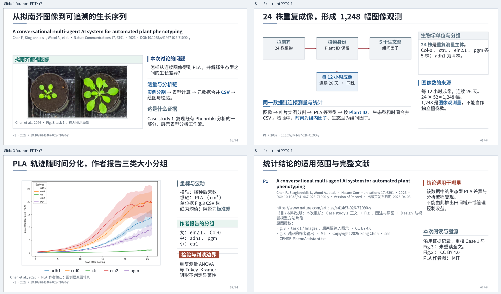

# v0.3.0 独立使用检查

## 任务与输入

给另一执行者提供原始 PhenoAssistant 论文记录、完整 Fig.3、作者独立 PLA 图及来源许可，让其从本版技能出发制作四页、三分钟组会节选。任务没有预先给出应采用的裁切、页型、字号、卡片配置或最终答案。它与主制作过程独立，使用当前 ChatGPT 环境中的正式 CLI，不是 DeepSeek 的效果评测。

## 实际完成

执行者读取技能与分阶段参考，局部重核 Design、Case study 1、Fig.3 图注及视觉模型方法。它明确没有重新精读整篇，记录本次实际阅读范围。导读使用输入照片局部，观测设计使用原生流程，PLA 结果比较候选后使用受控自定义图框，并补充原生图例。完整题名在导读与书目均出现。

调用了 init、record、reference、build、edit、render、review、check 八种正式命令。首轮 PPTX 画面暴露侧栏溢出与裁切标题残片，随后以新资产 ID 与限定页面编辑修复；最终四页真实渲染逐页查看，字体无缺失。

最终 PPTX SHA-256：`33fcf1ed80a639d3408412269bf3375caca85e62f2cd0023ef7919c42361e195`。

最终检查为 **0 错误、1 保留告警**，当前项目返回 `readyForDelivery=true`。告警是未测量原图最小必要字形高度；执行者实际逐项查看了轴、图例、曲线与误差，未填写虚构测量值。55 个原生文字对象、2 个独立图片对象和 4 页备注可在文件中核对，完整源媒体的摘要一致。

## 保留的问题

- 工程语义 schema 没有 partial-text 选项，本次局部复核使用 metadata-only 并在阅读说明中列出实际已读段落；不能据此声称本次完成全文精读。
- 初次读取的 figure 分类拼图尚未与当时正在改动的目录同步。发布前已由最终 48 页实际渲染更新，此条记录保留为过程观察。
- 一次当前构建状态异常在正式重建后恢复，未复现、未归因；没有以手改 artifact/history 消除问题。现有成品文件未被覆盖。
- 首次发表日与 Version of record 日期应分别理解，不应把两类日期简单判为文献错误。
- 三分钟仅为时间预算；未朗读计时，未做现场投影或 PowerPoint/WPS GUI 编辑。

具体结构化记录见 [forward-review-v0.3.0.json](forward-review-v0.3.0.json)。这次演练说明技能能引导独立执行者选择图片、比例、信息层级并在实际画面后修订；它不能证明任意模型、主题或长综述都获得同等效果。
