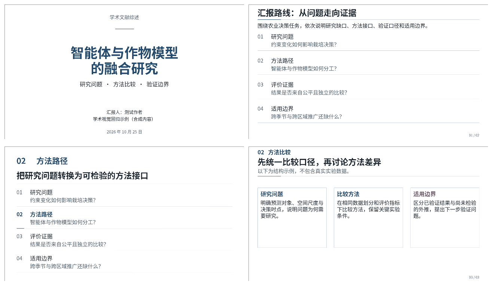

# rc.5 学术视觉与导航样张

这四张图来自插件生成的原生 PPTX，经 LibreOffice WASM、Noto Sans CJK SC Regular/Bold 实际渲染，输出96 dpi。它们是软件与版式回归用的合成内容，不是实际论文综述或实验结果；图片未经版式重排或修图，不使用用户上传的参考截图。

| 样张 | 检查的行为 |
| --- | --- |
| [文字主导封面](cover.png) | 完整研究题名、报告性质和身份层级，没有封面图片 |
| [问题式目录](roadmap.png) | 同一论证路线生成章节名称及本节问题 |
| [章节定位](section.png) | 当前节名称、全稿序号和高亮一致 |
| [细描边卡片](cards.png) | 真实可编辑细轮廓，无默认粗强调条或阴影 |

卡片页用于检查独立容器边界，不要求完整报告反复使用三列。目录和分节是可选原生布局，实际报告仍由内容决定页序和构图。对比度回归只覆盖内置色板的指定文字/背景组合，不代表所有自定义颜色或投影环境。

构造与导出行为由 `test/academic-style.test.mjs`、`test/academic-palette.test.mjs`、`test/narrative.test.mjs` 和 `test/story-workflow.test.mjs` 覆盖。样张不替代用户 DSH Desktop/Web、PowerPoint/WPS 或投影现场的检查。具体软件与实际制稿验证见 [本轮记录](../../docs/VALIDATION_V07_RC5.md)。
