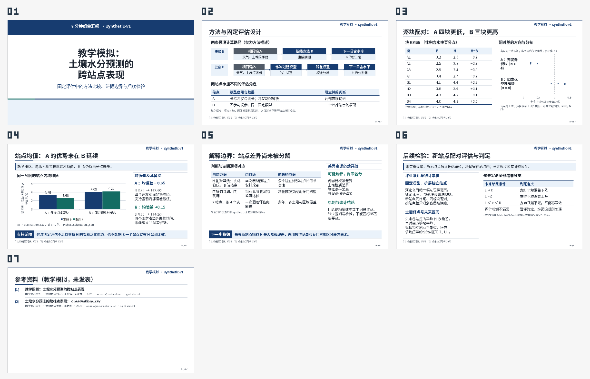

# 内容驱动构图：7 页教学模拟试用

本例由一个未继承重构聊天、诊断或旧成稿的执行者，根据原始协议和 8 行 CSV，使用 `0.6.0-dev.0` 插件完成。任务只指定中文组会、7 页和 8 分钟预算，可选参考包内的 experiment.pptx；没有预先给出结论大纲或指定页面构图。

这是一次宿主 agent 制作试用，不是真实 DSH / DeepSeek 端到端验收。试用期间插件仍有兼容性修正，因此不是冻结版本盲测或严格 A/B 实验。输入是专为软件验证编写的教学模拟，不代表农业研究结果。详细验证范围见[开发版验证记录](../../docs/VALIDATION_V06.md)。

## 查看实际成稿

[可编辑 PPTX](report.pptx) · [完整讲稿](speaker-notes.md) · [著述记录](deck.json) · [原始协议](sources/protocol.md) · [原始 CSV](sources/observations.csv) · [计算结果](analysis/calculations.json)

逐页查看：[1 封面](previews/page-0001.png) · [2 方法与设置](previews/page-0002.png) · [3 配对数据](previews/page-0003.png) · [4 站点均值](previews/page-0004.png) · [5 解释边界](previews/page-0005.png) · [6 后续判定](previews/page-0006.png) · [7 参考资料](previews/page-0007.png)

## 观察到的设计行为

- 工程选择 `reference-guided`；5 个正文页均使用自编 composition 与 visualPlan，没有使用 referenceTemplateId。
- 页面根据任务采用双路径方法图、原始表与差值分布、均值图与解释旁栏、证据矩阵、未来判定表；3 个关键页记录了其他方案及取舍。
- 实际采用 plain / rule 两类面板外观。没有为了演示功能而使用全部 surface，也没有为了求变化强迫每页不同。
- 8 行原始数据、A 的开发角色、B3 的反例、块与站点的区别及未实施方案身份均保留。A 的平均配对差为 −0.65，B 为 +0.15，单位均为体积含水率百分点；当前结果没有编造区间或显著性。

## 文件身份与检查

成稿来自作者 r9。PPTX 和 7 页图片保留原始字节；讲稿正文原文保留，仅规范化文件末尾的多余空行。整理者没有重排页面或修图。制作者实际看过当前全部 7 页，整理者又查看了同一版本的概览、全部单页与讲稿，并对照原始资料核对数值和结论边界。

制作者在制作中修正过拥挤和表达问题，不能把最终结果当作一次通过。480 秒是逐页讲述预算，未做真人排练。

| 检查 | 结果 |
| --- | --- |
| PPTX SHA-256 | `aad6a1ddb7ad527145fe65e6d3da571bc4077e13ced260e1e7a58f4c165736b7` |
| 实际渲染 | 可选 LibreOffice WASM 引擎，7 页；提供 Noto Sans CJK SC 字体后，缺失字体列表为空 |
| 原生对象解析 | 7 页、7 页备注、168 个原生 shape、4 个原生表格、1 个原生 chart、0 个图片对象 |
| 内容和显示 | 当前版本未发现需修正的阻断问题；不代替领域评审或 PowerPoint/WPS 多平台验收 |

方法图和分布图使用原生形状，均值图为原生图表；不能将所有形状都称作 PowerPoint 语义连接器。文件摘要与大小见 [manifest.json](manifest.json)。

`deck.json` 仅保留 title、brief、design、papers、claims、assets、slides 七个著述字段。仅将两条 paper.reading.source 改为本目录相对路径，其余字段与原稿相同；未携带旧工程的能力声明、产物状态或视觉审查。重新导入时需按新工作区解析这两个路径，经 init / recordsPath 重新登记，并对新产物重新检查。该文件不是可直接作为 recordsPath 提交的批次，也不是原工程状态文件。

当前 `npm run demo` 仍针对历史 materials-v05 样例；这里提供可检查的完整记录与成稿，不将旧入口的验证改称本例重建。所有新增模拟输入与记录适用本仓库 [MIT 许可](../../LICENSE)；运行字体不随样例分发。
