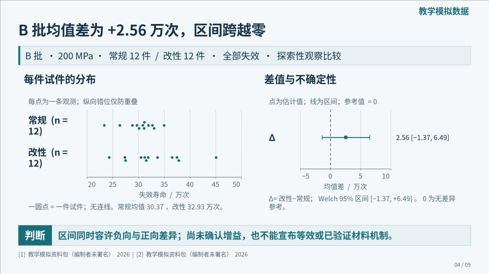

# v0.6.0 独立材料试用：可见卡片与内容构图

一位 `fork_turns:none` 的新上下文制作者，只获得插件快照、原始教学协议、48 行 CSV 与普通制作任务，完成了 **9 页、555 秒预算**的报告。没有提供模板 PPT、旧成稿、诊断截图或预先算好的结论。全部资料明确为教学模拟，不代表真实材料实验。

## 查看成品

- [可编辑 PPTX](report.pptx) · [实际渲染 PDF](report.pdf) · [逐页讲稿](speaker-notes.md)
- [全稿概览](overview.png) · [全部实际页面](previews/)
- [最终声明式记录](deck.json) · [输入协议](inputs/protocol.md) · [48 行 CSV](inputs/fatigue.csv)
- [计算与边界](analysis/calculation-notes.md) · [精确统计量](analysis/summary.json) · [计算脚本](analysis/calculate.py)
- [作者逐页观察](review/final-review.json) · [主线程独立复核](review/independent-review.json) · [技术历史](review/workflow-notes.md) · [原始任务](review/author-brief.md)

## 观察结果

作者自行选择 `content-led / compact`，全部页面没有 `referenceTemplateId`。封面用自定义题名、身份和副题区域；正文分别采用条件矩阵、原生条形图、原始点与区间图、解释关系、分流汇合流程和预定判据；结尾采用主判断、证据与行动卡、讨论问题。使用轮廓与浅底卡片、可编辑语义图标和逐页 chrome，没有为了展示能力强行加入无来源图片。

最终公开检查为 **0 错误、2 提醒**，缺失字体为空。主线程逐页查看全部 9 张最终 PNG，核对讲稿、原始协议和数据，并独立重算 B 批均值差与 Welch 区间，接受此版本，保留 3 项可优化意见：第 2 页单位换行、第 6 页短末行，以及只有两项真实来源的书目页大空区。书目页不作为正文紧凑设计通过的证据。第 8 页右下区域仍有约 22.07% 的几何提醒，已结合实际阅读顺序审查；这不是零留白或审美分数。

可编辑对象核对：**265 个原生形状、2 个表格、1 个原生图表、0 个图片对象、9 页备注**。最终 PPTX SHA-256：`9ab556280b94b29549dc9fbf93b2ec1948e27664fc4fefa2739a8f2498c889e7`。PPTX、PDF、讲稿与逐页图保留作者交付字节，主线程未另行重排或美化。

科学判断限定于观察资料：B 批同为 200 MPa，两工艺各 12 件，差值为 +2.562225 万次，探索性 95% 区间为 −1.36797991 至 +6.49242991 万次。当前不能确认增益或等效；C 批两件 runout 保留行政右删失身份，跨批、应力混杂和未测机制仍被保留。下一批随机验证明确尚未实施。

## 版本与复现

初次小样遇到环境缺 `/tmp`，设置工作区 `TMPDIR` 后成功。制作期间收到两次纯运行补丁：封面语境图片裁切、显式 chrome 的自由图框边界。材料稿未使用这两个图像字段，但最终仍以第三份快照重新构建和逐页审查。最终 124 文件快照摘要为 `47775856c2dbc5994295d937d4f525094850d96295dc11ef606a308d467c865f`，运行与技能文件与发布代码一致。详细迭代记录见[本版验证](../../docs/VALIDATION_V06.md)。不把此过程描述为全程冻结、一次成功或独立操作系统沙箱。

在仓库根目录运行 `npm run demo -- --output NEW_DIRECTORY`，默认从本例记录创建新工程；需要实际 PNG/PDF 时增加 `--render --font-dir WORKSPACE_FONT_DIRECTORY`。输出目录必须位于当前工作区且尚不存在。新产物不会继承作者视觉审查，需重新查看；重建不是新增模型试用。历史版本用 `--example materials-v05`。

发布前已从这些公开记录重建并实际渲染：9 张 PNG 与作者最终页面逐字节相同，逐页讲稿也相同；新 PPTX 的哈希不同，未自动移植旧审查。公开计算脚本重算的 `summary.json` 与作者精确统计结果一致。逐页哈希和运行范围见[重建验证](review/rebuild-verification.json)。

如需重算数值，安装 `requirements.txt` 中的 SciPy 后运行 `python examples/materials-v06/analysis/calculate.py`。公开整理只将源文件和计算输出路径改为相对路径，并更正脚本使用说明；公式、输入与精确结果不变。字体不随此公共示例再分发，原渲染使用 Noto Sans CJK SC Regular/Bold。
