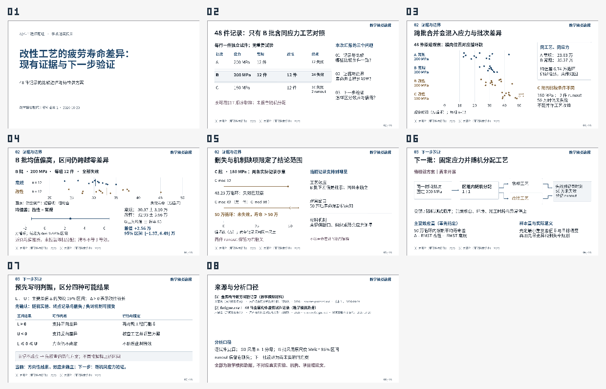

# 疲劳寿命进展报告：8页 / 8分钟

这是一份材料工程课题组学术沟通示例。唯一原始资料为随附 `sources/protocol.md` 和 `sources/fatigue.csv`；两者均保留教学模拟身份，不对应真实实验、机构、项目或论文。未使用外部文献、模板教学正文或其他报告结论。

这是 v0.7.0-rc.5 / renderer 12 的单例试作。制作者以新上下文读取原始材料和当前技能，自行安排论证与版面；未继承本次改动诊断、旧稿或测试结论。实际制作包含契约修正、候选选择与逐页返工，不代表一次成功或目标模型的稳定成功率。

[可编辑PPTX](delivery/fatigue-progress.pptx) · [PDF](delivery/fatigue-progress.pdf) · [讲稿](delivery/speaker-notes.md) · [重建入口](rebuild.sh) · [逐页预览](delivery/pages/) · [完整核验记录](delivery/verification-summary.json)



## 交付入口

- `delivery/fatigue-progress.pptx`：8页可编辑PPTX，图中的点、线、文字和流程节点均为原生对象。
- `delivery/fatigue-progress.pdf`、`delivery/pages/`、`delivery/preview.png`：由当前PPTX产生的实际渲染及全稿预览。
- `delivery/speaker-notes.md`：对应逐页讲稿；预算合计480秒，没有声称真人排练。
- `rebuild.sh`：从原始资料和作者脚本生成新的可恢复工程及成品，工程位于指定输出目录的 `project/project.json`。公开包不包含制作期间的完整工程历史快照。
- `delivery/sources/`：与报告一同交付的原始资料。第8页采用 `sources/...` 相对来源标识。
- `candidate-selection.json`：两个封面及两个证据页的实际候选选择依据。
- `delivery/review-final.json`、`delivery/check-final.json`、`delivery/verification-summary.json`：当前哈希的逐页视觉记录、可计算检查和实质限制。

[四页实际设计候选](study/candidates.pptx)及其[并列预览](study/preview.png)保留选择时版本，最终正文另有单位、尺度与随机分配报告状态的修订。[主线程复核](review/root-review.json)记录实际查看范围与最终文件身份。

## 重建

保持本目录位于插件仓库的第二级，例如 `.test-output/forward-rc5` 或 `examples/story-v07`。脚本从 `../../src/core.mjs` 导入插件公共接口，不修改插件源代码。环境需要本仓库依赖、Node、Python 3和SciPy，以及可用的Noto Sans CJK SC字体。

在本目录执行，并给出尚不存在的新输出目录：

```bash
DSH_FONT_DIRS='["/path/inside/workspace/to/cjk-fonts"]' bash ./rebuild.sh all ./rebuilt
```

`DSH_FONT_DIRS` 接受最多4个字体目录组成的JSON数组。省略时使用工作区下的 `visual-qa/fonts`。`DSH_WORKSPACE_ROOT` 可指定公共core的路径边界，默认是插件仓库的父目录；字体和输出须位于该工作区内。`DSH_INPUT_DIR` 默认是本目录的 `sources`。脚本校验两份资料的固定SHA256，输入变化时须重新审查主张和画面，不能继续沿用当前结论。

`rebuild.sh` 设置 `TMPDIR` 为仓库的 `.test-output/tmp`，先复算统计，再依次调用公共core的init、record、study、check、build和render。`all` 会重建4页候选和8页报告；`complete` 可对已存在的工程按公共edit入口重建。脚本不会自动生成新的视觉通过记录。

保留的构建与审查回执中仍有制作时的绝对路径。运行上述脚本会生成新的工程、成品和路径回执；无需手工修改历史记录。

## 报告的判断与边界

B批在200 MPa下两工艺各12件，均已失效。样本均值差（改性减常规）为25,622.25循环，原尺度Welch 95%区间为−13,679.80至64,924.30循环。该区间依赖独立试件与分布/抽样近似，不包含选择或混杂偏倚。资料明确没有随机跨批次分配，B批内部的随机分配未报告，不能把同批同应力当作随机化证据。

C批两条500,000循环记录为runout，表示最后观察时仍未失效。它们不提供50万循环之后的失效时刻。断口、微观组织和残余应力测量没有提供，因此报告没有补写材料机制。

下一批是尚未开展的方案：固定200 MPa、同批区组内随机分配、共同50万循环观察窗口，预先指定限制平均寿命差、工程最小重要差值δ、样本量与判定逻辑。δ和样本量未被资料确定，报告没有虚构具体值。

## 实际复核范围

已实际查看最终PPTX的全部8张PNG及概览。已修正第3页应力单位断行、第5页共同尺度/零起点/循环单位，以及对B批随机分配报告状态的限定。中文、负号、±、≤、Δ和δ的实际字形已检查。

检查保留3个提醒：路线页同时承载样本矩阵，自动分类未把它计作该节正文；封面与来源页有用于层次和分组的留白。对应内容已在实际画面中确认，没有通过删除材料或降低要求消除提醒。

本交付没有进行PowerPoint/WPS用户宿主测试，也没有真人排练。静态渲染使用Noto Sans CJK SC，缺失字体列表为空。详细哈希、原生对象计数和重建一致性记录见 [verification-summary.json](delivery/verification-summary.json)。
